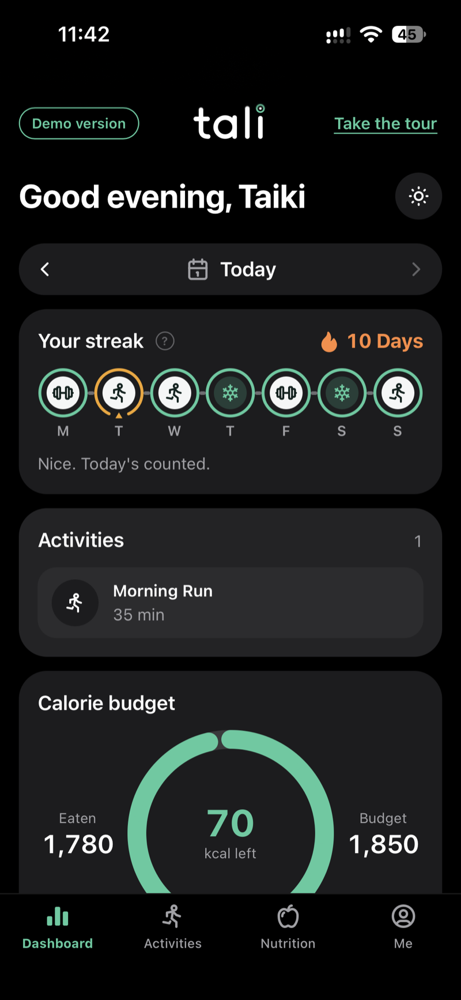
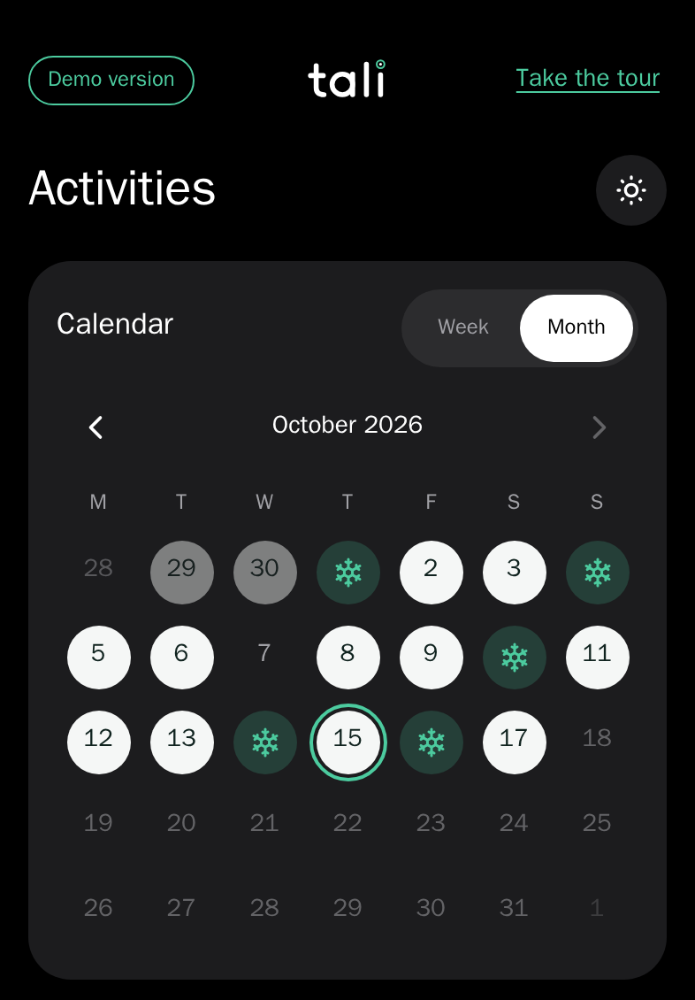
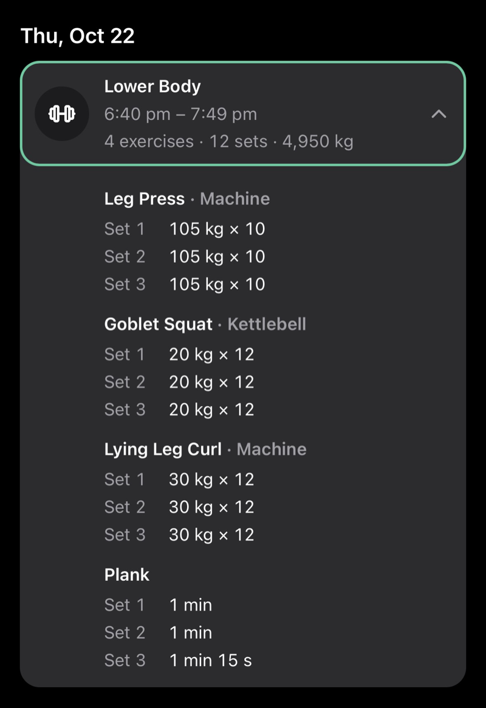
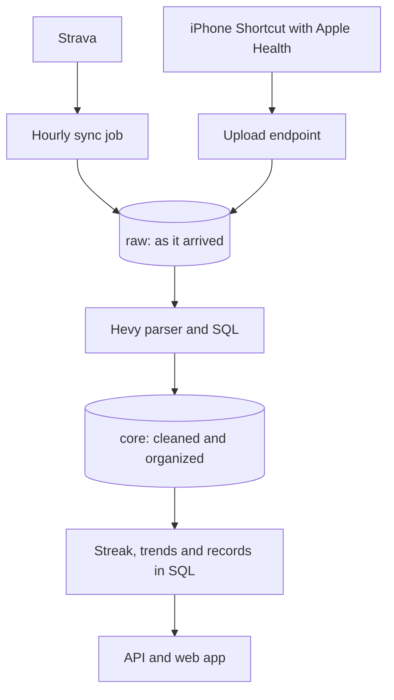

# Tali Fitness

I track my lifting in Hevy, my running in Strava, and my food in MyNetDiary. Each one does its job well, but none of them shows me everything together.

Tali Fitness is a passion project centered around consistently making good lifestyle choices day-by-day. The name "tali" comes from the Filipino word for "string". A core part of the app is maintaining a streak of activities connected by a string. The goal of the app is to help users not "break the chain" of good habits. This is rooted in the Seinfeld Strategy, a method of building good habits by visually tracking consistency over time.

The name "tali" is also a play on words for "tally", with the core identity of the app being a tracker for fitness metrics. 

[Try the demo](https://tali-fitness-demo.vercel.app) · [See how it works](https://tali-fitness-demo.vercel.app/how-it-works)

I built Tali as a means to stay consistent towards achieving my fitness goals by allowing me to stay accountable and track my progress over time. Tali Fitness pulls data from multiple sources into one database and shows them in a web app made for my phone. It keeps a daily streak, tracks my calories and protein against my targets, and lists every gym session set by set, with personal records and trends.

| Dashboard | Calendar | Gym session |
|---|---|---|
|  |  |  |
| The streak, today's activities and how much of the calorie budget is left. | White circles are workout days, snowflakes are rest days. | A gym session, rebuilt set by set from the text Hevy sends to Strava. |

All screenshots come from the demo, which runs on synthetic data.

## What it does

- Keeps a daily streak. A day with a workout or food logged keeps it going. Two days over budget in a row, two rest days in a row, or a day with nothing logged ends it.
- Shows calories and protein for any day, against the targets I had on that day.
- Puts workout days and rest days on a calendar, by week or by month.
- Breaks each gym session into exercises and sets.
- Finds personal records and counts weekly sets per muscle group.
- Draws weekly and monthly trends for training, food and body weight.
- Shows on the Me page when each source last synced and whether the data checks passed, with a Sync now button.

## Tech stack

The data side is PostgreSQL and SQL, with Alembic for database changes, Apache Airflow for scheduling on my machine and GitHub Actions for scheduling in production. The API is Python with FastAPI. The web app is React and TypeScript, built with Vite, and its charts are drawn in SVG. Everything runs in Docker Compose locally, and the live app is hosted on Vercel with its database on Neon. Tests use pytest, Vitest and Playwright.


## How it works



Strava can push new workouts to an app, but only to a public address that answers quickly, and a missed push means a missed workout. Instead, I poll so that once an hour a job asks Strava for anything new and opens each activity, because Hevy writes the workout into the activity's description. Locally that job runs in Apache Airflow, a scheduler for data jobs. The live app runs the same code from a scheduled GitHub Actions job.

Food and weight take a different approach. MyNetDiary writes to Apple Health, and an iPhone Shortcut runs when I close MyNetDiary. It reads the last two days from Apple Health and uploads them to the app with a token that only works for that upload.

Everything is stored in three layers. The raw layer holds everything exactly as it arrived. The core layer holds it cleaned and organized as a star schema: event tables (workouts, sets, food entries) linked to small lookup tables (dates, exercises, activity types). The streak, trends and records are worked out from core when a page is opened, so nothing has to be recalculated overnight.

Keeping the raw copy matters because parsers have bugs. When I fix one, I rerun it over everything in raw without asking Strava again. Syncing is also safe to repeat: each Strava activity is saved under its Strava ID, so saving it twice just overwrites the same row, and a food upload replaces that day's entries instead of adding to them.

### Example: reading a Hevy workout

Hevy sends each workout to Strava as plain text, one line per set. My first parser only understood sets with a weight and reps. My second sample session had pull-ups, cycling and planks, which it would have set aside forever, so now each set records what kind of set it is.

These lines come from my real (redacted) sessions, plus one line from the tests:

```
Standing Calf Raise (Dumbbell)
Set 1: 40 lbs x 12
Set 2: 3mi - 30min
Plank
"Planking all my life"
Set 1: 31s
```

The parser turns them into one record per set:

| Exercise | Equipment | Set | Kind | Value |
|---|---|---|---|---|
| Standing Calf Raise | Dumbbell | 1 | weight and reps | 18.14 kg (40 lb) x 12 |
| Plank | none | 1 | time | 31 seconds, with the note "Planking all my life" |

It can't read `Set 2: 3mi - 30min`, because Hevy has never sent miles in my data. It doesn't guess. The line goes to a quarantine table with its line number and a reason, and the rest of the session still loads. The Me page lists it, so I see it and can teach the parser the new format.

## Testing

The pipeline and API tests run against a real Postgres database, because that's where the rules live. The parser is tested on real Hevy text from my own sessions. The streak rules are tested as day sequences like the week above, and every example in the app's own streak explainer is checked against the same SQL. After each sync, a set of SQL checks looks for problems such as a source that stopped syncing, a duplicate activity or a set that can't be right, and each check has one test that makes it pass and one that makes it fail. Other tests prove the demo's login can't write anything or open the real database. GitHub runs all of it on every push, along with linting, type checks and a scan for leaked secrets.

```bash
make check    # everything CI runs
make test     # just the tests
```

## How to run

You need an installation of Docker and `make`. Everything else runs in containers, and you don't need any accounts to try the demo.

```bash
git clone https://github.com/imrobee/tali-fitness.git
cd tali-fitness
cp .env.example .env
make up          # the database, the API, Airflow and the web app
make migrate     # create the tables
make seed-demo   # build the demo; open http://localhost:5174
```

The app itself is at http://localhost:5173. It starts empty, and with the example `.env` you sign in with the key `change-me`. To use it with your own data, you need:

- A Strava API application, with its ID and secret in `.env`, then `make strava-auth` once.
- Hevy connected to your Strava account, so lifting sessions reach Strava.
- An iPhone Shortcut that reads Apple Health and uploads to `/api/v1/ingest/health`, with a token from `python3 scripts/make_ingest_token.py`. The upload format is in [docs/ARCHITECTURE.md](docs/ARCHITECTURE.md).

`make down` stops everything.

## Planned features

- **Sleep tracking:** Sleep is an important factor in recovery and performance, so tracking sleep quality (e.g., sleep scores, bedtime adherence) over time will contribute to a more holistic approach to fitness tracking. I am currently exploring how it can be integrated in the app and its possible dynamic with the streak counter.


