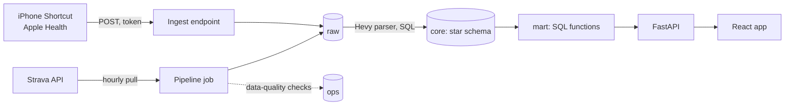

# Tali Fitness

One place for my lifting, running and nutrition data.

[Live demo](https://tali-fitness-demo.vercel.app) (made-up data, with a guided tour) · [How it works](https://tali-fitness-demo.vercel.app/how-it-works) · [](https://github.com/imrobee/tali-fitness/actions/workflows/ci.yml)

I track my lifting in Hevy, my running in Strava, and my food in MyNetDiary, and none of them shows me everything together. So I built a data pipeline that pulls all three into one PostgreSQL database, and a phone-first web app on top of it. It shows a daily streak, my calories and protein against my targets, every gym session set by set, personal records, and weekly and monthly trends.

| Dashboard | Calendar | A gym session, parsed into sets |
|---|---|---|
|  |  |  |

All screenshots are from the demo, which runs on synthetic data.

## What it does

- **Daily streak.** A day keeps the streak if something was logged and it isn't the second over-budget day or second rest day in a row. The rules are written once and shown in the app.
- **Calories and protein** for any day, against the budget and goal that were in effect that day.
- **Calendar** of workout days and rest days, by week or month. Tap a day to see what was done.
- **Gym sessions set by set**, read from the workout text that Hevy sends to Strava.
- **Personal records** (estimated one-rep max) and sets per muscle group per week.
- **Trends**: training time, running distance, lifting volume, average calories and protein, and body weight against a goal.
- **Pipeline health** on the Me page: when each source last synced, the data-quality results, and any lines the parser set aside.
- **Sync now**, for when I don't want to wait for the hourly pull.

## How it works



Strava can push updates, but that needs a public address that answers quickly, and a missed push means a missed workout. I poll instead: once an hour a job asks Strava for new activities and opens each one, because the list doesn't include the description where Hevy writes the workout. Food and weight come from Apple Health (MyNetDiary writes to it): an iPhone Shortcut runs when I close MyNetDiary and posts the last two days to an endpoint that only accepts its own token.

Everything lands unchanged in a `raw` schema first, then is parsed and modeled into a star schema (`core`). Hevy sends each workout to Strava as plain text, one line per set. A parser turns each line into a record, and any line it can't read is set aside with a reason, so the rest of the session still loads. The streak, each day's status, the trends and the records are SQL functions that run when a page asks for them.

More detail: [docs/ARCHITECTURE.md](docs/ARCHITECTURE.md) (the data model is section 5) and every decision with its reason in [docs/DECISIONS.md](docs/DECISIONS.md).

## Design decisions

**Land raw data first, then transform (ELT).**
Hevy's text format turned out to have four kinds of set, and I expect more surprises. Keeping every Strava response in `raw` means a parser fix can replay all of history without calling Strava again: bumping the parser's version re-parses every activity. The alternative, parsing before storing (ETL), would lose anything the parser misread. ([D49](docs/DECISIONS.md), D33)

**Every load can run twice without creating duplicates.**
Strava rows are upserted by their id, one activity per transaction, so a killed run keeps its progress and a retry rewrites the same rows. A nutrition batch replaces only the (day, type) pairs it contains, which also makes edits in Apple Health come through. I rejected de-duplicating by hash, because a hash can't tell an edited food entry from a new one. Tests run each load twice and compare. (D1, D20, D30)

**Poll Strava hourly instead of using webhooks.**
Webhooks need a public address that answers fast, and a missed push is a missed workout. Each poll starts seven days before the newest activity it has, so a workout edited within a week is picked up again. The cost is up to an hour of delay, which Sync now covers. (D50, D78)

**Business rules live in SQL functions, computed when a page is opened.**
The streak is two functions: one labels each day using `LAG` over the day before, the other finds the current run of days with a running `SUM` (the gaps-and-islands pattern). Because the rule is in the database, I test it against real Postgres with 20 day-by-day scenarios, and nothing has to be recomputed on a schedule. The alternative was the same logic in Python, which the database tests couldn't reach. (D38, D42, D96)

**Targets are effective-dated, so history stays honest.**
Changing my calorie budget inserts a new row that applies from today; past days keep the budget they had, so last month's streak doesn't quietly change. Relaxed weekends and the weight goal work the same way. In the demo, a visitor's changed budget applies to every day instead, only for their own requests, and is never saved. (D86, D97, D122)

**The demo is a separate service, database and read-only role.**
The demo service connects as a role that can only read the demo database and cannot connect to the real one, and it refuses to start if any real credential is set. A bug in the demo has nothing to reach my data with, because the demo process never holds a credential for it. Tests check that the demo's role can't write, can't read the token or session tables, and can't open the real database. I rejected one API holding both databases' credentials and choosing per visitor. The demo's data is built by replaying synthetic Strava and Shortcut payloads through the real pipeline code, so it is also an end-to-end test. (D118, D119, D121)

**Airflow locally, a GitHub Actions schedule in production, running the same code.**
There is no free always-on host for Airflow. Each Airflow task's body is a plain function in `pipeline/include/jobs.py`; the DAGs call them locally, and the hourly GitHub Actions job calls the same functions in the same order, writing the same run records. (D132)

## Data quality and testing

- **15 data-quality checks**, one SQL file each, run after every sync. They look for things like a source that stopped syncing, a set or a day's calories outside a sane range, duplicate activities, raw and core row counts that disagree, and parser coverage under 95%. Results show on the Me page. Each check has a test that makes it pass and one that makes it fail.
- **Parser golden tests** on real (redacted) Hevy text: one session must parse to 22 sets totalling exactly 3,490.8973504 kg; another mixes bodyweight, distance and timed sets.
- **Streak rules** tested as day sequences in real Postgres, plus every example in the in-app explainer.
- **Demo isolation tests**: every write of the real app is refused on the demo, and real and demo sessions don't open each other's app.
- **Security tests**: every API route is public on purpose or guarded, sign-in against a fake Google, and a leak test with canary secrets. gitleaks scans the full git history.

CI runs `make -k check` on every push: lint, typecheck, the production web build, all tests against a real Postgres, the secret scan and a bundle check. The same command runs locally. In a clean clone on 2026-11-08, that was 477 API tests, 240 pipeline and SQL tests, and 258 web tests, all passing.

```bash
make check     # what CI runs
make test      # tests only
```

## Run it locally

You need Docker and `make`. Everything else runs in containers.

**Without any accounts** (the demo on synthetic data):

```bash
git clone https://github.com/imrobee/tali-fitness.git
cd tali-fitness
cp .env.example .env
make up            # Postgres, the API, Airflow and the web app
make migrate       # build the schemas
make seed-demo     # build the demo database and open it at http://localhost:5174
make check         # lint, typecheck and every test
```

The app itself is at http://localhost:5173; with the example `.env` you sign in with the key `change-me`. It starts empty.

**With your own data**, you need:

- A Strava API application (from strava.com/settings/api): put its id and secret in `.env`, then run `make strava-auth` once. Airflow (http://localhost:8080) then pulls your activities hourly.
- Lifting from Hevy appears once Hevy is connected to your Strava account.
- An iPhone Shortcut that reads Apple Health and posts to `/api/v1/ingest/health`. `python3 scripts/make_ingest_token.py` makes its token; the payload is in [docs/ARCHITECTURE.md](docs/ARCHITECTURE.md) section 6.2.

`make down` stops everything. `make db-reset` deletes all local data.

## Tech stack

- **Data:** PostgreSQL, SQL (functions, window functions, constraints), Alembic migrations, Apache Airflow (local), GitHub Actions (scheduled jobs in production).
- **Backend:** Python, FastAPI, SQLAlchemy Core with parameterized SQL files, psycopg, Authlib for Google sign-in.
- **Frontend:** React, TypeScript, Vite, React Router, TanStack Query. Charts and the tour are hand-written SVG.
- **Tooling:** Docker Compose, pytest, Vitest, Testing Library, Playwright, ruff, oxlint, gitleaks.
- **Hosting:** Vercel (web and API), Neon (Postgres).

## Limits, and what I'd change at scale

- **One user by design.** Sign-in allows exactly one Google account, and the tables have no user column. More users would mean a user id on every table, and per-user Strava tokens.
- **Free tiers.** The first request after a quiet spell wakes both Vercel and Neon, so it is slow: in one test from Manila, the first request to an idle demo took about 3 seconds and the next one 0.15. Rate limits are kept in memory, so each Vercel instance counts separately.
- **No Airflow in production.** The hourly job has no per-step retries; the next run resumes from the watermark. GitHub can delay scheduled runs and switches them off after 60 days without activity in a public repository. The freshness check turns that into a warning on the Me page.
- **The parser depends on Hevy's text format.** If Hevy changes it, the new lines are set aside rather than guessed, and the data-quality checks flag the session.
- **Strava's terms.** Strava data may only be shown to the person it belongs to, so the real app is sign-in only and the public demo uses made-up data. Location data is dropped before anything is stored.
- **Small gaps I accepted:** deleting the last food entry of a day doesn't propagate, and activities deleted on Strava are not removed.
- **The demo rebuild** makes one database round trip per statement; it takes seconds locally and minutes from GitHub's runners to Neon.

**Not built yet:** a shareable Shortcut for other people, Strava webhooks, removing activities deleted on Strava, and batching the demo rebuild.

## Repository layout

```
api/        FastAPI app: routes, sign-in, ingest, the demo service, and their tests
pipeline/   Airflow DAGs and the pipeline code they share with production: Strava client, Hevy parser, loads, checks
db/         Alembic migrations, SQL files (API queries, transforms, data-quality checks), seed CSVs
web/        React app, unit tests and Playwright specs
scripts/    one-off and CI helpers: the production pipeline runner, demo seeding, token setup
docs/       architecture, decisions, plan, UI spec, redacted samples, screenshots
.github/    CI, the hourly pipeline, migrations, and the demo rebuild
```

## Credits and license

Strava, Hevy and MyNetDiary are trademarks of their owners. Tali Fitness uses the Strava API to read my own activities, and is not affiliated with, endorsed by or sponsored by Strava, Hevy or MyNetDiary.

No license: the code is public to read, and all rights are reserved.
