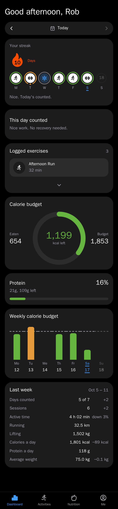
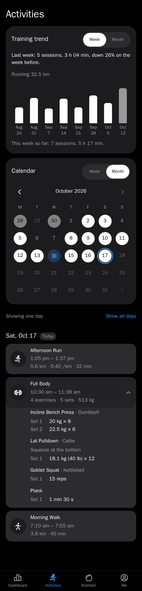
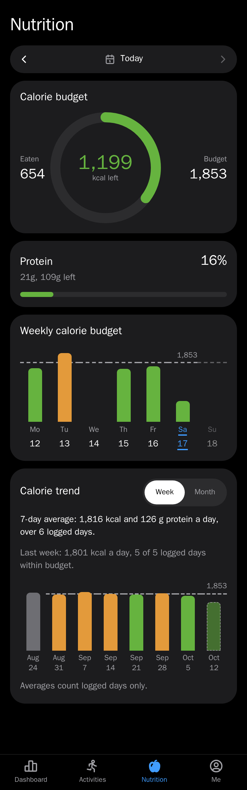
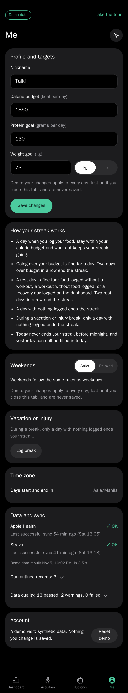

# fitness-tracker

*"My training, running and nutrition data lives in separate apps that don't talk to each other, so I built a pipeline that joins them."*

Strava activities (pulled by Airflow) and Apple Health nutrition data (pushed by an iOS Shortcut) land in a PostgreSQL warehouse, and a mobile-first web app shows the results. Design docs: [docs/ARCHITECTURE.md](docs/ARCHITECTURE.md), [docs/PROJECT_PLAN.md](docs/PROJECT_PLAN.md), [docs/DECISIONS.md](docs/DECISIONS.md).

## Quickstart (local)

Needs only **Docker Desktop** and **make**.

```bash
cp .env.example .env      # then fill in the Strava keys
make up                   # build and start postgres, api, airflow, web
make migrate              # create the warehouse schemas
make strava-auth          # once: authorize Strava (follow the prompts)
make check                # lint, typecheck, and all tests (same as CI)
```

| Service | URL |
|---|---|
| Web app | http://localhost:5173 (on the iPhone: `http://<mac-lan-ip>:5173`) |
| API health | http://localhost:8000/api/v1/health |
| Airflow UI | http://localhost:8080 (login: `AIRFLOW_ADMIN_USER` / `AIRFLOW_ADMIN_PASSWORD` from `.env`) |
| Postgres | `127.0.0.1:5433`, databases `app` and `airflow` |

Open the web app, enter the `API_KEY` from `.env` once, and set a calorie budget and protein goal on the Me page.

## Demo and screenshots

A separate demo stack (its own database `app_demo`, key `demo-key`, clock frozen at Sat 2026-10-17 14:00) never touches real data.

```bash
make seed-demo SCENARIO=midweek   # or at_risk, edge_empty; then open http://localhost:5174
make screenshots                  # iPhone and desktop screenshots of every scenario into docs/screenshots/
```

| Dashboard | Activities | Nutrition | Me (data and sync) |
|---|---|---|---|
|  |  |  |  |

Other scenarios: [at risk](docs/screenshots/at_risk-iphone.png), [stale pipeline](docs/screenshots/at_risk-me-iphone.png), [nothing set up yet](docs/screenshots/edge_empty-iphone.png), [desktop](docs/screenshots/midweek-desktop.png), [trends by month](docs/screenshots/midweek-activities-month-iphone.png).

Other commands: `make down`, `make logs`, `make test`, `make lint`. `make db-reset` deletes all local data.
