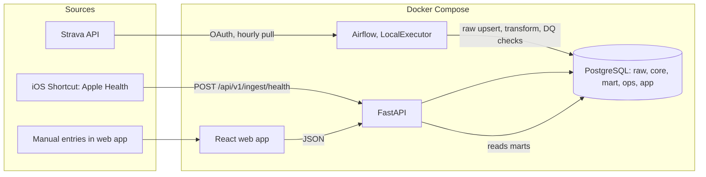

# Architecture

Source of truth for data, rules, pipelines, and the API. Where this file marks **ASSUMPTION**, build the default, isolate it behind config, and revisit after the Slice 0 spike.

## 1. Overview



Pattern: **ELT**. Land raw data unchanged (`raw`), transform with SQL and a small Python parser into a star schema (`core`), expose business logic as views/functions (`mart`), serve JSON from FastAPI. All business rules (qualifying day, freeze, streak, calorie status) live **in SQL**, so the logic is testable against a real database and is the interview story. The front end only renders.

## 2. Services (Docker Compose, local only)

| Service | Image / build | Host port | Notes |
|---|---|---|---|
| `postgres` | `postgres:16` | `127.0.0.1:5432` | Two databases: `app` (warehouse) and `airflow` (Airflow metadata). Init script creates both |
| `airflow` | Official Apache Airflow image, **current stable release pinned after reading the official docs** | `127.0.0.1:8080` | **LocalExecutor only** (no Celery, no Redis). Mounts `pipeline/dags` and `pipeline/include`. Prefer the lightest official way to run it in one container for dev. Target well under 2 GB RAM |
| `api` | Build `./api` | `0.0.0.0:8000` | `uvicorn --reload` in dev. Reachable from the iPhone at `http://<mac-lan-ip>:8000` |
| `web` | Build `./web` (Node) | `0.0.0.0:5173` | `vite --host`; dev proxy `/api` to `http://api:8000` (same origin, no CORS pain) |

`.env.example` keys: `POSTGRES_USER`, `POSTGRES_PASSWORD`, `WAREHOUSE_URL`, `API_KEY`, `APP_TIMEZONE=Asia/Manila`, `STRAVA_CLIENT_ID`, `STRAVA_CLIENT_SECRET`, `BACKFILL_DAYS=90`, `AIRFLOW_ADMIN_USER`, `AIRFLOW_ADMIN_PASSWORD`, `APP_ENV=dev`, `NOW_OVERRIDE` (only honored when `APP_ENV` is `dev` or `test`; used for fixtures and screenshots).

DB access: SQLAlchemy Core with `text()` and parameters, using `WAREHOUSE_URL`, from both the API and Airflow tasks (one way to talk to Postgres, easy to explain). Alembic runs migrations; write them as explicit SQL (`op.execute`).

## 3. Repository layout

```
.
├── CLAUDE.md  README.md  Makefile  docker-compose.yml  .env.example  .gitignore
├── .github/workflows/ci.yml
├── docs/            PROJECT_PLAN.md  ARCHITECTURE.md  UI_SPEC.md  DECISIONS.md
│   ├── samples/     redacted Strava JSON, Shortcut payloads, Hevy text
│   ├── design-reference/   reference images (strava widget, mynetdiary, concept mock)
│   └── screenshots/        output of `make screenshots`
├── db/
│   ├── migrations/  Alembic versions (schemas, tables, SQL functions/views)
│   ├── sql/         transform SQL (one file per step; loaded by DAG tasks)
│   └── seeds/       dim_activity_type.csv  exercise_muscle_map.csv
├── api/             FastAPI app (app/), tests/
├── pipeline/        dags/  include/ (clients, parsers, loaders)  tests/
├── web/             React + Vite + TypeScript (src/, tests/, e2e/)
└── scripts/         strava_auth.py  seed_demo.py  send_sample_shortcut_payload.sh
```

The Hevy parser lives in `pipeline/include/parsers/hevy.py` and is a **pure function** (text in, dataclass out). The API does not import from `pipeline`.

## 4. Time and "day" (decided once, used everywhere)

- A **day** is a local calendar date, midnight to midnight. A record's `local_date` is computed **once at ingestion from the record's own local time** and stored. Nothing re-derives a day from UTC later.
  - Strava: use `start_date_local` (wall-clock time at the activity) and the `timezone` field. Strava formats `start_date_local` with a trailing `Z` even though it is local time: strip the `Z` and treat the value as **naive local time**; never parse it as UTC. The IANA name comes from `timezone` (format `"(GMT+08:00) Asia/Manila"`). Covered by a unit test.
  - Shortcut samples: use the ISO-8601 timestamp's own offset. A timestamp without an offset is interpreted in the batch's `device_tz`, else in the profile timezone.
- `app.profile.timezone` (IANA name, default `Asia/Manila`) defines **"today"** and the week boundaries for display. It is editable later. Rob does not travel now; storing `local_date` per record keeps history correct if that changes, and changing the profile timezone only moves "today".
- Week = Monday to Sunday (`dim_date.week_start`).
- The API computes `today`, the greeting, and all "now" logic using the profile timezone and the `NOW_OVERRIDE` clock hook. The browser never decides what day it is.
- Greeting boundaries (local): 05:00-11:59 morning, 12:00-17:59 afternoon, 18:00-04:59 evening.

## 5. Data model

Schemas: `raw` (landing, never edited), `core` (star schema), `mart` (views and functions that hold business rules), `ops` (pipeline metadata), `app` (user-entered data).

### 5.1 `raw`
| Table | Grain / key | Columns (key ones) |
|---|---|---|
| `raw.strava_activities` | one row per Strava activity; PK `strava_id` | `payload jsonb`, `fetched_at` |
| `raw.health_batches` | one row per accepted Shortcut POST; PK `batch_id uuid` | `received_at`, `window_start`, `window_end` (dates), `payload_sha256`, `payload jsonb`, `applied_at` (set by `core.apply_health_batch` in the ingest transaction) |
| `raw.health_samples` | one row per sample; PK `(batch_id, idx)` | `type`, `value`, `unit`, `start_ts timestamptz`, `local_date`, `source` |

### 5.2 `core` (star schema)
| Table | Kind | Grain / key | Columns (key ones) |
|---|---|---|---|
| `core.dim_date` | dim | one row per date, 2020-01-01 to 2035-12-31; PK `date_key` (`YYYYMMDD` int) | `date`, `iso_year`, `iso_week`, `week_start` (Monday), `month_start`, `dow`, `is_weekend` |
| `core.dim_activity_type` | dim | PK `activity_type_key`; unique `strava_sport_type` | `app_type` in (`run`,`walk`,`cycle`,`swim`,`strength`,`yoga`,`hiit`,`other`), `label` |
| `core.dim_exercise` | dim | PK `exercise_key`; `UNIQUE NULLS NOT DISTINCT (exercise_name, equipment)` (a plain unique treats NULL equipment as distinct, so `ON CONFLICT` would insert a duplicate on every re-parse) | `exercise_name` ("Incline Bench Press"), `equipment` ("Dumbbell", nullable), `muscle_group` (default `Unmapped`) |
| `core.fact_activity` | fact | one row per Strava activity; PK `activity_key`; unique `strava_id` | `date_key`, `activity_type_key`, `title`, `started_at timestamptz`, `started_local timestamp`, `ended_at`, `tz`, `duration_s` (Strava `elapsed_time`), `moving_s`, `distance_m`, `avg_hr`, `calories_burned`, `description_raw`, `parse_status` in (`ok`,`partial`,`not_hevy`,`not_applicable`) |
| `core.fact_set` | fact | one row per set; PK `set_key`; unique `(activity_key, exercise_order, set_number)` | `activity_key` (FK, cascade), `date_key`, `exercise_key`, `exercise_order`, `set_number`, `weight_kg numeric`, `reps`, `orig_weight`, `orig_unit` in (`kg`,`lb`), `volume_kg` (generated: `weight_kg * reps`) |
| `core.fact_dietary_sample` | fact | one row per health sample after batch replacement; PK `sample_key` | `batch_id`, `date_key`, `local_date`, `sample_type` in (`energy`,`protein`), `value` (kcal or g), `start_ts`, `source` |

Seeds: `dim_activity_type` maps Strava `sport_type` to `app_type` (Run, TrailRun, VirtualRun to `run`; Walk, Hike to `walk`; Ride and variants to `cycle`; Swim to `swim`; WeightTraining to `strength`; Yoga, Pilates to `yoga`; HIIT, Crossfit to `hiit`; everything else to `other`). `exercise_muscle_map.csv` starts with the nine exercises in the sample (Incline Bench Press to Chest, Lat Pulldown to Back, Goblet Squat to Quads, Lying Leg Curl to Hamstrings, Standing Calf Raise to Calves, Preacher Curl to Biceps, Triceps Rope Pushdown to Triceps, Lateral Raise to Shoulders, Cable Core Pallof Press to Core). Unknown exercises load as `Unmapped` and trigger a DQ warning. Primary muscle group only in v1.

### 5.3 `app` (user-entered)
| Table | Notes |
|---|---|
| `app.profile` | single row (`id = 1`): `nickname`, `timezone` (default `Asia/Manila`) |
| `app.target_history` | PK `effective_from date`; `calorie_budget int CHECK (> 0)`, `protein_goal int CHECK (>= 0)`. The target "in effect" on date `d` is the row with the greatest `effective_from <= d`. Editing targets inserts a row effective **today**, so history never changes |
| `app.recovery_day` | PK `day date`; `note text`; `created_at` |

### 5.4 `ops`
`ops.pipeline_runs` (`run_id`, `source`, `started_at`, `finished_at`, `status` in `success|failed|partial`, `rows_read`, `rows_written`, `rows_quarantined`, `error_message`, `airflow_run_id`); `ops.watermarks` (`source`, `value`); `ops.oauth_tokens` (`provider`, `access_token`, `refresh_token`, `expires_at`); `ops.quarantine` (`id`, `source`, `entity_id`, `line_no`, `raw_content`, `reason_code`, `error`, `first_seen_at`, `resolved_at`); `ops.dq_results` (`check_name`, `severity`, `status`, `observed_value`, `threshold`, `checked_at`, `run_id`).

### 5.5 `mart`
Views/functions: `fn_day_status(p_today date)` (section 8), `fn_streak(p_today date)`, `v_daily_nutrition` (kcal and protein per local date joined to the target in effect), `v_week_calories`, `v_activity_day`. Later: `v_pr`, `v_weekly_summary`, `v_muscle_volume_week`, `v_trends_*`. Anything with a `today` is a **function taking `p_today`** so tests control the clock.

Write-side function outside `mart`: `core.apply_health_batch(p_batch_id uuid)` applies one health batch to `core` (section 6.2).

## 6. Ingestion

### 6.1 Strava to raw (Airflow DAG `strava_sync`)
- Schedule hourly, `catchup=False`, `max_active_runs=1`, retries with exponential backoff, `execution_timeout`.
- Tasks: `refresh_token` (token stored in `ops.oauth_tokens`; **do not pass tokens through XCom**) -> `fetch_activities` -> `load_raw` -> `transform_core` -> `parse_hevy` -> `record_run` (`trigger_rule=all_done`, so failures are logged too).
- Incremental: `after = watermark - 7 days` (lookback catches edited descriptions). The list endpoint returns summaries; **fetch the detail endpoint** for ids that are new or inside the lookback window, because the description may only be in the detail response (verify in Slice 0). Cap detail fetches per run to respect rate limits (Strava docs, checked 2026-10-20: read limit 100 requests per 15 minutes and 1,000 per day; headers `X-ReadRateLimit-Limit` / `X-ReadRateLimit-Usage`; over the limit returns 429; 15-minute windows reset at :00/:15/:30/:45, daily at midnight UTC). First run backfills `BACKFILL_DAYS` over several runs.
- Idempotent: raw upsert by `strava_id`; `core.fact_activity` upsert by `strava_id`; `fact_set` for an activity is **deleted and re-inserted in one transaction** on each parse.
- Strava deletions are not reconciled in v1 (Backlog).
- Never call the live Strava API in tests. Use recorded JSON from `docs/samples/` behind a small client interface.

### 6.2 Apple Health to raw (FastAPI `POST /api/v1/ingest/health`)

**ASSUMPTION (confirm in Slice 0 with the real Shortcut output):**
```json
{
  "window": {"from": "2026-10-18", "to": "2026-10-19"},
  "device_tz": "Asia/Manila",
  "samples": [
    {"type": "dietary_energy",  "value": 540, "unit": "kcal", "start": "2026-10-19T12:41:00+08:00", "source": "optional"},
    {"type": "dietary_protein", "value": 32,  "unit": "g",    "start": "2026-10-19T12:41:00+08:00"},
    {"type": "body_mass",       "value": 72.4, "unit": "kg",  "start": "2026-10-19T06:58:00+08:00"}
  ]
}
```
- **Design: replace per (date, type).** The Shortcut sends *all* samples for a date window (today and yesterday). Applying a batch replaces, in `core.fact_dietary_sample`, only the `(local_date, sample_type)` pairs that have **at least one sample in the batch**; pairs with no samples are left untouched. That makes edits and deletions in Apple Health propagate, protects a day when one type comes back empty (for example Health data unreadable while the iPhone is locked), and re-sending the same payload leaves the data unchanged (idempotent). Rationale: hash-only de-duplication cannot handle an edited food entry; whole-window replace can wipe a type that failed to load.
- **Known limitation:** deleting the *last* entry of a type on a day does not propagate (the pair has no samples, so it is not replaced). Record in DECISIONS.
- **Applied synchronously.** The ingest endpoint, in **one transaction**: inserts `raw.health_batches` and `raw.health_samples`, writes rejects to `ops.quarantine`, calls `core.apply_health_batch(batch_id)` (deletes the batch's `(local_date, sample_type)` pairs from `core.fact_dietary_sample`, inserts the batch's accepted dietary samples, sets `applied_at`), and writes an `ops.pipeline_runs` row with `source = 'health'`. Any error rolls back the whole batch. No Airflow DAG and no lag for health data.
- Fallback if the Shortcut cannot send a window: de-duplicate on `sha256(type|start|end|value|unit|source)`. State the limitation (no edit/delete propagation) in DECISIONS.
- Validation (Pydantic + DB `CHECK`): `type` in the three allowed values (`dietary_energy`, `dietary_protein`, `body_mass`); energy `0 < value <= 5000` kcal (convert kJ to kcal at 0.239006 kcal per kJ); protein `0 <= value <= 500` g; body mass `30 <= value <= 250` kg (sanity range; any unit other than `kg` is `bad_unit`); `start` ISO-8601 (naive means `device_tz`); every sample's `local_date` must fall inside the window; window spans at most 7 days and does not end after tomorrow. Invalid samples go to `ops.quarantine` (reason codes `bad_unit`, `out_of_range`, `outside_window`, `bad_timestamp`) and the rest of the batch is still accepted.
- Empty `samples` returns 422 `empty_batch` (an empty run means the Shortcut failed; rejecting it makes the failure visible). Same `payload_sha256` as the latest batch with the same window returns 200 with `duplicate: true` and inserts nothing.
- Response: `{"batch_id": "...", "received": 12, "accepted": 11, "rejected": 1, "duplicate": false}`.
- Per-item pairing of calories to protein is **not needed**: the app only uses per-day sums, so the two types are aggregated independently.
- **Body mass** (`body_mass`, kg): one sample per weigh-in, sent in the same batch. It lands in `raw.health_samples` only; it is **not** loaded into `core.fact_dietary_sample` (dietary only) and never affects `has_calories` or the streak. The core table for weight is designed with the weight-trend feature (PROJECT_PLAN Slice 7b) and uses the same per-(date, type) replace. Daily weight rule: section 14, #8.

### 6.3 Data quality (Airflow DAG `data_quality`)
- Hourly, `catchup=False`, `max_active_runs=1`. Runs every enabled check in section 9, writes `ops.dq_results`, and writes an `ops.pipeline_runs` row with `source = 'dq'`. It is the only place checks run, so Strava and health data are checked on the same schedule.

## 7. Hevy parser

Input: Strava `description` text. Marker line `Logged with hevyapp.com` identifies a Hevy description; without it, `parse_status = not_hevy` (not an error).

Line grammar (tolerant of blank lines, trailing spaces, and extra whitespace):
- **Exercise header:** a non-empty line that is not a set line. Split `Name (Equipment)` into `exercise_name` and `equipment`; no parentheses means `equipment = null`.
- **Set line:** `Set <n>: <weight> <unit> x <reps>` with unit `kg` or `lb`/`lbs` (case-insensitive) and decimals allowed (for example `22.5 kg x 8`).
- Normalize to kg with `1 lb = 0.45359237 kg`. Keep `orig_weight` and `orig_unit`.
- Any line that matches neither (bodyweight sets, time sets, distance sets, supersets, RPE notes, anything new) goes to `ops.quarantine` with `line_no`, `raw_content`, and `reason_code = unparsed_line`; the activity becomes `partial`. **Never drop silently. Never guess.** Extend the grammar test-first when Rob provides more samples.
- A header with zero sets is quarantined (`empty_exercise`).

**Golden test** (`docs/samples/hevy_description_01.txt`): 9 exercises, 22 sets, total `volume_kg` = 3490.9 (rounded to 2 dp; exact 3490.8973504). Per exercise volumes: Incline Bench Press 580, Lat Pulldown 592, Goblet Squat 360, Lying Leg Curl 288, Standing Calf Raise 653.173 (40 lb), Preacher Curl 217.724 (20 lb), Triceps Rope Pushdown 360, Lateral Raise 220, Cable Core Pallof Press 220.

## 8. Qualifying day, freeze, and streak (all in SQL)

### 8.1 Definitions
- `has_activity(d)`: at least one `core.fact_activity` on local date `d`. No minimum duration (config `MIN_ACTIVITY_MINUTES = 0`).
- `has_calories(d)`: at least one `energy` sample on `d`.
- `qualifying(d) = has_activity(d) AND has_calories(d)`. Workout length and over/under budget are irrelevant.
- `recovery_logged(d)`: row in `app.recovery_day`.
- `calorie_status(d)`, first match wins: `not_logged` (no energy sample), `not_set` (calories logged but no budget in effect on `d`; never marked over), `within` (`kcal <= budget in effect on d`), `over`.

### 8.2 The freeze rule (plain English)
Rob has **one freeze**. Logging a recovery day uses it. The freeze **resets on the next day that has both a workout and logged calories**. Consequence: a recovery day is valid only if the **previous calendar day qualified** (or it is the first day of data). Two non-qualifying days in a row therefore break the streak.
- A valid recovery day is **transparent**: it does not add to the streak and does not break it.
- A recovery day logged when the previous day did not qualify is **invalid** and treated like a missed day.
- A day that qualifies is `qualifying` even if a recovery day was logged for it (the freeze is released).
- Recovery days can be created only for **today or yesterday** (backfill window).
- v1 supports exactly one freeze. If Rob wants more later, the rule needs a running counter (recursive CTE or PL/pgSQL), not a `LAG`.
- `freezes_left(d)` for display: `1` if `d` qualifies, or `d` is not a recovery day and the previous day qualified (or first day); `0` if `d` is a valid recovery day, or the previous day did not qualify.

### 8.3 Day states and streak
States for each day up to `today`:

| State | Rule (first match wins) |
|---|---|
| `qualifying` | `qualifying(d)` |
| `recovery` | `recovery_logged(d)` AND previous day qualified (or first day) |
| `today_pending` | `d = today` |
| `at_risk` | `d = today - 1` (healable until midnight; **does not break the chain yet**) |
| `missed` | everything else (breaks the chain) |
| `future` | `d > today` (only for the 7-day grid) |

Streak = number of `qualifying` days in the chain that contains `today`. Chains are separated by `missed` days (gaps-and-islands). `at_risk` flag = yesterday is `at_risk` AND the chain has at least one qualifying day. While `at_risk` is true the UI shows the unchanged count plus a quiet message; healing yesterday (workout + calories, or a valid recovery day) clears it; at midnight an unhealed yesterday becomes `missed`.

SQL sketch (the real function must pass 8.4):
```sql
-- mart.fn_day_status(p_today date): one row per day from first data day to p_today
WITH days AS (
  SELECT d::date AS day
  FROM generate_series((SELECT first_day FROM bounds), p_today, interval '1 day') AS d
), flags AS (
  SELECT day,
    EXISTS (SELECT 1 FROM core.fact_activity a WHERE a.date_key = to_char(day,'YYYYMMDD')::int) AS has_activity,
    EXISTS (SELECT 1 FROM core.fact_dietary_sample s WHERE s.local_date = day AND s.sample_type = 'energy') AS has_calories,
    EXISTS (SELECT 1 FROM app.recovery_day r WHERE r.day = days.day) AS recovery_logged
  FROM days
), q AS (
  SELECT *, (has_activity AND has_calories) AS qualifying,
         LAG(has_activity AND has_calories) OVER (ORDER BY day) AS prev_qualifying
  FROM flags
), st AS (
  SELECT *, CASE
      WHEN qualifying                                        THEN 'qualifying'
      WHEN recovery_logged AND COALESCE(prev_qualifying,true) THEN 'recovery'
      WHEN day = p_today                                     THEN 'today_pending'
      WHEN day = p_today - 1                                 THEN 'at_risk'
      ELSE 'missed' END AS state
  FROM q
)
SELECT *, SUM((state = 'missed')::int) OVER (ORDER BY day) AS island_id FROM st;

-- streak: qualifying days in the island that contains p_today
```

### 8.4 Mandatory SQL integration tests (real Postgres)
Notation: oldest to newest, last item is today. `Q` qualifying, `R` valid recovery, `M` nothing, `A` activity only, `C` calories only, `T` today with nothing yet, `Tq` today qualifying, `Rq` recovery logged on a day that also qualifies.

| # | Sequence | Streak | `at_risk` | Notes |
|---|---|---|---|---|
| 1 | `Q Q Q T` | 3 | false | today pending never breaks |
| 2 | `Q Q Q Tq` | 4 | false | |
| 3 | `Q R Q T` | 2 | false | `R` transparent |
| 4 | `Q R R Q Q T` | 2 | false | second `R` invalid, acts as `missed` |
| 5 | `Q M Q Q T` | 2 | false | older `M` breaks |
| 6 | `Q Q M T` | 2 | true | yesterday is `at_risk` |
| 7 | `Q Q M Tq` | 3 | true | today counts on top of the pre-miss chain |
| 8 | `Q Q M T` then backfill yesterday as `Q` | 3 | false | heal with workout + calories |
| 9 | `Q Q M T` then log yesterday as recovery (day before it was `Q`) | 2 | false | heal with the freeze |
| 10 | `Q Q R(today)` | 2 | false | `freezes_left(today) = 0` |
| 11 | `M M T` | 0 | false | no chain to protect |
| 12 | `R Q T` | 1 | false | first-day recovery valid |
| 13 | `Q Rq Q T` | 3 | false | qualifying wins over recovery |
| 14 | `Q Q(over budget) Q T` | 3 | false | over budget never affects the streak |
| 15 | `Q A T` | 1 | true | activity without calories does not qualify |
| 16 | `Q R M Q T` | 1 | false | recovery then a miss breaks |
| 17 | `Q C T` | 1 | true | calories without activity does not qualify |

Also test: sample at 23:59 local counts for that date; target history (budget changed mid-week does not rewrite past `calorie_status`).

## 9. Data-quality checks (run after loads; write `ops.dq_results`)

| Check | Rule | Warn | Fail |
|---|---|---|---|
| `strava_freshness` | age of last successful Strava sync | > 6 h | > 24 h |
| `health_freshness` | age of last health batch | > 48 h | > 96 h |
| `activity_unique` | duplicate `strava_id` in `core.fact_activity` | none | any |
| `activity_not_null` | `started_at`, `date_key`, `duration_s` not null | none | any |
| `activity_duration_range` | `0 < duration_s <= 86400` | any outlier | none |
| `set_range` | `0 < weight_kg <= 500`, `1 <= reps <= 100` | any outlier | none |
| `calorie_daily_range` | daily energy total `<= 10000` | any outlier | none |
| `fk_integrity` | facts reference existing dims | none | any orphan |
| `row_reconcile` | `raw.strava_activities` count equals `core.fact_activity` count | none | mismatch |
| `hevy_parse_coverage` | share of Hevy activities with `parse_status = ok`, last 30 days | < 95% | < 80% |
| `quarantine_open` | open quarantine rows | > 0 | > 25 |
| `unmapped_exercises` | exercises with `muscle_group = 'Unmapped'` | > 0 | none |
| `possible_duplicate_activity` | two activities on one day with overlapping time (Apple Watch plus Hevy) | any | none |
| `target_present` | at least one `app.target_history` row | missing | none |
| `days_with_activity_no_calories` | last 14 days (information only) | n/a | n/a |

Checks are plain SQL files returning `(observed_value, status)`. No external DQ framework in v1. They run in the `data_quality` DAG (6.3).

**Staging:** M1 ships 5 checks: `strava_freshness`, `health_freshness`, `activity_unique`, `row_reconcile`, `hevy_parse_coverage`. All 15 are due by M2. **Every check has a pass test and a fail test** against real Postgres.

## 10. Pipeline observability

Every DAG run and every health ingest writes `ops.pipeline_runs`. `GET /api/v1/pipeline/health` returns, per source (`strava`, `health`): `last_success_at`, `status` (`ok` within the warn threshold, `delayed` between warn and fail, `failed` beyond fail or last run failed), `failures_7d`; plus `quarantine` (open count, counts by reason, the 20 most recent items with a raw snippet) and `dq` (passed, warnings, failed, list). The Me page renders this (see `UI_SPEC.md`).

## 11. API contract (v1)

Base `/api/v1`. All endpoints except `/health` require `X-API-Key`. JSON in and out; errors are `{"error": {"code": "...", "message": "..."}}` with codes `unauthorized`, `invalid_payload`, `empty_batch`, `date_out_of_range`, `recovery_not_allowed`.

| Method | Path | Purpose |
|---|---|---|
| GET | `/health` | liveness, no auth |
| GET | `/dashboard?date=YYYY-MM-DD` | composed payload for the dashboard (below) |
| GET | `/activities?from=&to=` | day-grouped summaries, newest first; default last 30 days |
| GET | `/activities/{id}` | detail: exercises, sets (kg, original unit), parse status, raw text if not `ok` |
| GET | `/nutrition?date=` | calorie card, protein card, week chart for the date |
| GET | `/me` | nickname, timezone, current targets, earliest data date |
| PUT | `/me` | nickname; targets (inserts `target_history` effective today) |
| POST | `/recovery` | `{date, note?}`; valid only for today/yesterday and per the freeze rule |
| DELETE | `/recovery/{date}` | undo |
| POST | `/ingest/health` | Shortcut push (section 6.2) |
| GET | `/pipeline/health` | health panel |
| GET | `/streak` | stretch: small JSON for Scriptable |

`GET /dashboard` response (draft; keep field names stable once the UI uses them):
```json
{
  "today": "2026-10-19",
  "selected_date": "2026-10-19",
  "earliest_date": "2026-08-01",
  "greeting": "Good afternoon",
  "nickname": "Rob",
  "streak": {
    "count": 6, "at_risk": false, "message": null,
    "week": [
      {"date": "2026-10-19", "weekday": "M", "state": "today_pending",
       "primary_activity_type": null, "calorie_status": "not_logged"}
    ]
  },
  "recovery": {"state": "available", "freezes_left": 1, "freezes_max": 1},
  "exercises": [
    {"id": 123, "type": "strength", "title": "Afternoon Weight Training",
     "started_at": "2026-10-19T15:02:00+08:00", "duration_s": 3480}
  ],
  "calories": {"eaten": 654, "budget": 1853, "remaining": 1199, "over": 0, "status": "within"},
  "protein": {"grams": 21, "goal": 130, "percent": 16},
  "week_chart": {
    "week_start": "2026-10-19",
    "bars": [{"date": "2026-10-19", "kcal": 654, "budget": 1853, "status": "within"}]
  }
}
```
`calorie_status` (streak week), `calories.status`, and `week_chart.bars[].status` take the values in section 8.1: `not_logged`, `not_set`, `within`, `over` (bars also `future`). With `not_set`, `budget`, `remaining`, and `over` are `null`.
`recovery.state` is one of `available`, `logged`, `no_freeze`, `blocked`, `counted`, `locked` (definitions in `UI_SPEC.md`). `exercises` are ordered **most recent first** by `started_at`. `week[].primary_activity_type` is the type of the **longest-duration** activity that day (it drives the circle icon). `week_chart` covers the Monday-Sunday week containing `selected_date`; the streak `week` is always the current week.

## 12. Security

- `X-API-Key` on every endpoint except `/health`; compare with `secrets.compare_digest`. The web app asks for the key once and keeps it in `localStorage` (never bundled into the JS).
- Request body limit on ingest (for example 1 MB). All SQL parameterized. Pydantic validation at every boundary.
- Secrets only in `.env`. Logs never print keys or tokens. Strava tokens in `ops.oauth_tokens` are acceptable for local dev; revisit for hosting.
- HTTP on the LAN is accepted for dev. HTTPS is mandatory before any public hosting (Slice 8).

## 13. Testing and CI

| Layer | Tool | What |
|---|---|---|
| Parser, validators, formatters | pytest | golden Hevy test, edge-case lines, kJ/kcal, range checks (incl. body mass), Strava `start_date_local` with trailing `Z` parsed as naive local |
| SQL rules | pytest + real Postgres | scenarios in 8.4 with helpers like `insert_day(date, activity=True, calories=500, recovery=False)`; idempotent loads (run twice); re-parse leaves `dim_exercise` unchanged (incl. NULL equipment) |
| Health apply | pytest + real Postgres | `core.apply_health_batch`: same batch twice is unchanged; edited entry replaces its pair; a type missing for a day leaves that pair untouched; failure mid-batch rolls back raw and core |
| Data quality | pytest + real Postgres | one pass test and one fail test per check |
| API | pytest + FastAPI `TestClient`, `NOW_OVERRIDE` | auth, error codes, dashboard payload per scenario (incl. `not_set`), recovery rules, targets history |
| DAGs | pytest | `DagBag` has zero import errors (`strava_sync`, `data_quality`); task functions with a stubbed Strava client |
| Web logic | Vitest + Testing Library | formatters, ring and chart math, card states from payloads |
| Visual | Playwright | screenshots per scenario at 393x852 and 1280x800 (see `UI_SPEC.md`) |

CI (GitHub Actions): ruff, pytest with a Postgres service container, DAG import test, web `tsc`, `vitest`, production build. Playwright screenshots run locally via `make screenshots` (upload as CI artifacts only if time allows).

## 14. Open decisions

| # | Question | Default | Resolve in |
|---|---|---|---|
| 1 | Shortcut payload shape; can it send a date window? | Replace per (date, type) for pairs present in the batch, applied synchronously (6.2); decided by Rob 2026-10-20. Exact fields still confirmed by the spike | Slice 0 |
| 2 | Does Strava's list endpoint include `description`? | Detail only: Strava reference shows it on `DetailedActivity`, not `SummaryActivity`. Confirm live in the spike | Slice 0 |
| 3 | Duration definition | `elapsed_time` for display, `moving_time` for run pace | Slice 2 |
| 4 | Apple Watch + Hevy create two activities for one session | Keep both; DQ warns on overlap; no auto-merge | Slice 4 |
| 5 | Which Hevy line formats beyond kg/lb sets exist | Quarantine unknowns | Slice 0 samples |
| 6 | Weight-trend data source | iOS Shortcut sends Apple Health Body Mass in kg, one sample per weigh-in (6.2) | Decided by Rob, 2026-10-20 |
| 7 | Hosting | Research in Slice 8 | Slice 8 |
| 8 | Several weigh-ins on one local date | The last reading of the day (latest `start` on that `local_date`) is that day's weight | Slice 7b (weight trend) |
| 9 | Strava `start_date_local` has a trailing `Z` | Treat as naive local time (section 4); decided by Rob 2026-10-20 | Slice 2 |
| 10 | Where DQ checks run | `data_quality` DAG, hourly (6.3); decided by Rob 2026-10-20 | Slice 5 |
