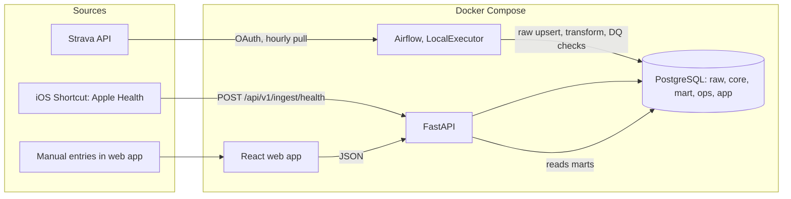

# Architecture

Source of truth for data, rules, pipelines, and the API. Where this file marks **ASSUMPTION**, build the default, isolate it behind config, and revisit after the Slice 0 spike.

## 1. Overview



Pattern: **ELT**. Land raw data unchanged (`raw`; one exception: Strava location fields are dropped, DECISIONS D24), transform with SQL and a small Python parser into a star schema (`core`), expose business logic as views/functions (`mart`), serve JSON from FastAPI. All business rules (kinds of day, what breaks the streak, calorie status) live **in SQL**, so the logic is testable against a real database and is the interview story. The front end only renders.

## 2. Services (Docker Compose, local only)

| Service | Image / build | Host port | Notes |
|---|---|---|---|
| `postgres` | `postgres:16` | `127.0.0.1:5433` (container port 5432; the Mac's own Postgres holds 5432) | Two databases: `app` (warehouse, `POSTGRES_DB`) and `airflow` (metadata, `db/init/01_create_airflow_db.sql`) |
| `airflow` | Build `./pipeline`, `FROM apache/airflow:3.3.2` (Python 3.13) | `127.0.0.1:8080` | `airflow standalone` in one container: **LocalExecutor only** (no Celery, no Redis), metadata in the `airflow` database. Mounts `pipeline/dags`, `pipeline/include`, `pipeline/tests`. Login from `AIRFLOW_ADMIN_USER` / `AIRFLOW_ADMIN_PASSWORD` (written to the simple auth manager's passwords file by `pipeline/start_airflow.sh`) |
| `api` | Build `./api` (`python:3.13-slim`, matches the Airflow image) | `0.0.0.0:8000` | `uvicorn --reload` in dev. Mounts `db/` for Alembic. Reachable from the iPhone at `http://<mac-lan-ip>:8000` |
| `web` | Build `./web` (Node) | `0.0.0.0:5173` | `vite --host`; dev proxy `/api` and `/auth` to `http://api:8000` (same origin: no CORS, and the session cookie belongs to the page's host) |

`.env.example` keys: `POSTGRES_USER`, `POSTGRES_PASSWORD`, `WAREHOUSE_URL`, the sign-in variables of `AUTH_SPEC.md` section 4 (`AUTH_MODE`, `PUBLIC_BASE_URL`, `GOOGLE_CLIENT_ID`, `GOOGLE_CLIENT_SECRET`, `OAUTH_STATE_SECRET`, `ALLOWED_GOOGLE_SUB`, `INGEST_TOKEN_SHA256`, `DEV_LOGIN_KEY`), `APP_TIMEZONE=Asia/Manila`, `STRAVA_CLIENT_ID`, `STRAVA_CLIENT_SECRET`, `BACKFILL_DAYS=90`, `AIRFLOW_ADMIN_USER`, `AIRFLOW_ADMIN_PASSWORD`, `APP_ENV=dev`, `NOW_OVERRIDE` (only honored when `APP_ENV` is `dev` or `test`; used for fixtures and screenshots).

DB access: SQLAlchemy Core with `text()` and parameters, using `WAREHOUSE_URL`, from both the API and Airflow tasks (one way to talk to Postgres, easy to explain). Alembic runs migrations; write them as explicit SQL (`op.execute`).

## 3. Repository layout

```
.
├── CLAUDE.md  README.md  Makefile  docker-compose.yml  .env.example  .gitignore
├── .github/workflows/ci.yml
├── docs/            PROJECT_PLAN.md  ARCHITECTURE.md  UI_SPEC.md  DECISIONS.md
│   ├── samples/     redacted Strava JSON, Shortcut payloads, Hevy text
│   ├── design-reference/   reference images (strava widget, mynetdiary, concept mock)
│   └── screenshots/        output of `make screenshots`
├── db/
│   ├── init/        one-time Postgres init (creates the `airflow` database)
│   ├── migrations/  Alembic versions (schemas, tables, SQL functions/views)
│   ├── sql/         transform SQL (one file per step; loaded by DAG tasks)
│   └── seeds/       dim_activity_type.csv  exercise_muscle_map.csv
├── api/             FastAPI app (app/), tests/
├── pipeline/        dags/  include/ (clients, parsers, loaders)  tests/
├── web/             React + Vite + TypeScript (src/, tests/, e2e/)
└── scripts/         seed_demo.py  send_sample_shortcut_payload.sh  spikes/
```

Pipeline code lives in `pipeline/include/` (for example `strava/client.py`, `strava/sync.py`) and is imported by thin DAG files; its SQL lives in `db/sql/`. The Hevy parser lives in `pipeline/include/parsers/hevy.py` and is a **pure function** (text in, dataclass out). The API does not import from `pipeline`.

## 4. Time and "day" (decided once, used everywhere)

- A **day** is a local calendar date, midnight to midnight. A record's `local_date` is computed **once at ingestion from the record's own local time** and stored. Nothing re-derives a day from UTC later.
  - Strava: use `start_date_local` (wall-clock time at the activity) and the `timezone` field. Strava formats `start_date_local` with a trailing `Z` even though it is local time: strip the `Z` and treat the value as **naive local time**; never parse it as UTC. The IANA name comes from `timezone` (format `"(GMT+08:00) Asia/Manila"`). Covered by a unit test.
  - Shortcut samples: use the ISO-8601 timestamp's own offset. A timestamp without an offset is interpreted in the batch's `device_tz`, else in the profile timezone.
- `app.profile.timezone` (IANA name, default `Asia/Manila`) defines **"today"** and the week boundaries for display. It is editable later. Rob does not travel now; storing `local_date` per record keeps history correct if that changes, and changing the profile timezone only moves "today".
- Week = Monday to Sunday (`dim_date.week_start`).
- The API computes `today`, the greeting, and all "now" logic using the profile timezone and the `NOW_OVERRIDE` clock hook. The browser never decides what day it is.
- Greeting boundaries (local): 05:00-11:59 morning, 12:00-17:59 afternoon, 18:00-04:59 evening.

## 5. Data model

Schemas: `raw` (landing, never edited), `core` (star schema), `mart` (views and functions that hold business rules), `ops` (pipeline metadata), `app` (user-entered data).

### 5.1 `raw`
| Table | Grain / key | Columns (key ones) |
|---|---|---|
| `raw.strava_activities` | one row per Strava activity; PK `strava_id` | `payload jsonb` (the detail response minus `map`, `start_latlng`, `end_latlng`, `segment_efforts`), `fetched_at` |
| `raw.health_batches` | one row per accepted Shortcut POST; PK `batch_id uuid` | `received_at`, `window_start`, `window_end` (dates), `payload_sha256`, `payload jsonb`, `applied_at` (set by `core.apply_health_batch` in the ingest transaction) |
| `raw.health_samples` | one row per **accepted** sample (rejected ones go to `ops.quarantine`), value and unit as received; PK `(batch_id, idx)` | `type`, `value`, `unit`, `start_ts timestamptz`, `local_date`, `source` |

### 5.2 `core` (star schema)
| Table | Kind | Grain / key | Columns (key ones) |
|---|---|---|---|
| `core.dim_date` | dim | one row per date, 2020-01-01 to 2035-12-31 (built in Slice 3 because `fact_dietary_sample` references it); PK `date_key` (`YYYYMMDD` int) | `date`, `iso_year`, `iso_week`, `week_start` (Monday), `month_start`, `dow`, `is_weekend` |
| `core.dim_activity_type` | dim | PK `activity_type_key`; unique `strava_sport_type` | `app_type` in (`run`,`walk`,`cycle`,`swim`,`strength`,`yoga`,`hiit`,`other`), `label` |
| `core.dim_exercise` | dim | PK `exercise_key`; `UNIQUE NULLS NOT DISTINCT (exercise_name, equipment)` (a plain unique treats NULL equipment as distinct, so `ON CONFLICT` would insert a duplicate on every re-parse) | `exercise_name` ("Incline Bench Press"), `equipment` ("Dumbbell", nullable), `muscle_group` (default `Unmapped`) |
| `core.fact_activity` | fact | one row per Strava activity; PK `activity_key`; unique `strava_id` | `date_key`, `activity_type_key`, `title`, `started_at timestamptz`, `started_local timestamp`, `ended_at`, `tz`, `duration_s` (Strava `elapsed_time`), `moving_s`, `distance_m`, `avg_hr`, `calories_burned`, `description_raw`, `parse_status` in (`ok`,`partial`,`not_hevy`,`not_applicable`; NULL = not parsed yet; `not_applicable` = no description, `not_hevy` = a description without the marker), `source_fetched_at` (the raw row's `fetched_at`), `parsed_fetched_at` (the raw version last parsed; re-parse when it differs), `parsed_at`, `parser_version` |
| `core.fact_set` | fact | one row per set; PK `set_key`; unique `(activity_key, exercise_order, set_number)` | `activity_key` (FK, cascade), `date_key`, `exercise_key`, `exercise_order` (position in the workout; the same exercise can appear twice), `set_number`, `set_kind` in (`weight_reps`,`reps`,`distance_duration`,`duration`), nullable `weight_kg numeric`, `reps int`, `distance_m numeric`, `duration_s int`, `orig_weight`, `orig_unit` in (`kg`,`lb`), `exercise_note text` (nullable; same value on every set of that exercise entry), `volume_kg` (generated: `weight_kg * reps` for `weight_reps`, else `0`). One `CHECK` per kind: `weight_reps` needs `weight_kg` and `reps`; `reps` needs `reps`; `distance_duration` needs `distance_m` and `duration_s`; `duration` needs `duration_s`; every column a kind does not use must be NULL |
| `core.fact_body_mass` | fact | one row per local day: the day's last weigh-in (latest `start`, then later batch position); PK `local_date`; `weight_kg numeric CHECK (30-250)` kept exact (lb conversions), `start_ts`, `batch_id`, `source`. Replaced per day by `core.apply_health_batch`, like the dietary pairs (migrations 0009, backfilled 0010) |
| `core.fact_dietary_sample` | fact | one row per health sample after batch replacement; PK `sample_key` | `batch_id`, `date_key`, `local_date`, `sample_type` in (`energy`,`protein`), `value` (kcal or g; kJ converted at 0.239006 kcal/kJ by `core.apply_health_batch`), `start_ts`, `source` |

Seeds are CSV files in `db/seeds/`, upserted by `transform_core` on every run (editing a CSV takes effect next run); sport types missing from the CSV are added automatically as `other`. `dim_activity_type` maps Strava `sport_type` to `app_type` (Run, TrailRun, VirtualRun to `run`; Walk, Hike to `walk`; Ride and variants to `cycle`; Swim to `swim`; WeightTraining to `strength`; Yoga, Pilates to `yoga`; HighIntensityIntervalTraining (Strava's name for HIIT), Crossfit to `hiit`; everything else to `other`). `exercise_muscle_map.csv` starts with the nine exercises in the sample (Incline Bench Press to Chest, Lat Pulldown to Back, Goblet Squat to Quads, Lying Leg Curl to Hamstrings, Standing Calf Raise to Calves, Preacher Curl to Biceps, Triceps Rope Pushdown to Triceps, Lateral Raise to Shoulders, Cable Core Pallof Press to Core), plus sample 02's Pull Up to Back, Push Up to Chest, Plank to Core, and Cycling to a `Cardio` group. Unknown exercises load as `Unmapped` and trigger a DQ warning. Primary muscle group only in v1.

### 5.3 `app` (user-entered)
| Table | Notes |
|---|---|
| `app.profile` | single row (`id = 1`): `nickname`, `timezone` (default `Asia/Manila`), `weight_unit` (`kg` or `lb`, default `kg`; Slice 7b). Weights are always stored in kg; the unit only changes how the web shows and asks for them, converting with the exact 0.45359237 kg per lb |
| `app.target_history` | PK `effective_from date`; `calorie_budget int CHECK (> 0)`, `protein_goal int CHECK (>= 0)`. The target "in effect" on date `d` is the row with the greatest `effective_from <= d`. Editing targets inserts a row effective **today**, so history never changes |
| `app.recovery_day` | PK `day date`; `note text`; `created_at`. A logged recovery day makes the day a rest day (section 8) |
| `app.streak_settings_history` | PK `effective_from date`; `lenient_weekends boolean`. Relaxed weekends in effect on `d` = latest row on or before `d`; strict when none (Slice 7d) |
| `app.vacation` | `id`; `start_date`, `end_date` (`CHECK end >= start`, fewer than 90 days). Vacation or injury: only a missed day breaks the streak. Past periods stay as history; the API keeps periods from overlapping and edits only the one still running or to come (Slice 7d) |
| `app.weight_goal_history` | PK `effective_from date`; `goal_kg numeric(5,1) CHECK (30-250)`. Its own table, so saving the calorie budget never clears the goal. The goal in effect on `d` is the latest row on or before `d` (Slice 7b) |

**Settings in effect on a day** (migration 0016, D122): every lookup of the three histories above goes through `app.target_on(d)`, `app.weight_goal_on(d)` and `app.lenient_weekends_on(d)`, and the profile's nickname and unit through `app.demo_setting`. Each returns the latest row on or before `d`, unless a demo visitor's own value is set for the current transaction (`set_config('demo.<name>', value, true)`, done by the demo API only), which then applies to every day. The real app never sets one, so for it these are the same rules as before.

### 5.4 `ops`
`ops.pipeline_runs` (`run_id`, `source`, `started_at`, `finished_at`, `status` in `running|success|partial|failed`, `rows_read`, `rows_written`, `rows_quarantined`, `error_message`, `airflow_run_id`); `ops.watermarks` (`source`, `value`); `ops.oauth_tokens` (`provider`, `access_token`, `refresh_token`, `expires_at`); `ops.quarantine` (`id`, `source`, `entity_id`, `line_no`, `raw_content`, `reason_code` in (`invalid_sample`, `unknown_type`, `bad_unit`, `out_of_range`, `outside_window`, `bad_timestamp`, `unparsed_line`, `empty_exercise`), `error`, `first_seen_at`, `resolved_at`); `ops.dq_results` (`id`, `run_id`, `check_name`, `status` in `pass|warn|fail`, `observed_value`, `threshold` (text), `checked_at`). No separate severity: `status` carries it. `ops.sync_requests` (`id`, `source` = `strava`, `requested_at`, `airflow_run_id`): one row per Sync now request (Slice 7c), for the 2-minute cooldown and for following the Airflow run.

### 5.5 `mart`
Views/functions: `fn_day_status(p_today date)` (section 8; one row per day with `kind`, `lenient`, `breaks`, `state`, `counted`, `island_id`), `fn_streak(p_today date)` (`streak`, `at_risk`, `today_state`, `today_kind`, `yesterday_kind`), `fn_daily_nutrition(p_from date, p_to date)` (kcal and protein per local date with the target in effect and `calorie_status`; a function with a date range so days without samples still appear as `not_logged`), `v_week_calories`, `v_activity_day`. Later: `v_pr`, `v_weekly_summary`, `v_muscle_volume_week`. Anything with a `today` is a **function taking `p_today`** so tests control the clock.

Trends (migration 0008, Slice 7a; functions rather than the planned `v_trends_*` views because they depend on today):
- `fn_periods(p_today, p_grain, p_count)`: the last `p_count` weeks (Monday-Sunday) or calendar months, ending with the one containing `p_today`.
- `fn_training_trend(p_today, p_grain, p_periods)`: per period `sessions`, `active_s` (sum of `duration_s`), `run_m` (runs only), `volume_kg`, `is_current`, and `active_change_pct` against the previous period with `LAG`. One extra hidden period is computed first, so the oldest period shown still has a `LAG` value. No change is stated against a period with no training (`NULLIF`).
- `fn_nutrition_trend(p_today, p_grain, p_periods)`: per period `days_logged`, `avg_kcal` and `avg_protein_g` **per logged day** (a day without food logged is missing data, not 0 kcal), `avg_budget` over logged days, `days_within`, `days_over`, a period `status` (`not_logged`, `not_set`, `within` if the average is at or under the average budget, else `over`), and `prev_avg_kcal` with `LAG`. Built on `fn_daily_nutrition`.
- `fn_weight_trend(p_from, p_to)` (Slice 7b): per day `weight_kg` (its day's last weigh-in), `avg_7d_kg` over the logged days of the last 7 calendar days, `change_7d_kg` (that average minus the one 7 days earlier, `LAG 7`), `goal_kg` in effect, and `status` (`not_logged`, `not_set`, `at_or_below`, `above`). It reads 13 days before `p_from`: 6 for the first average, 7 for the change.
- `fn_personal_records(p_today)` (Slice 7b): per exercise, the best estimated 1RM (Epley `weight * (1 + reps / 30)`, `weight_reps` sets of 1-12 reps on or before `p_today`) chosen with `RANK()` (a tie keeps the earlier set), the set it came from, the best before it (a running `MAX() OVER ... ROWS BETWEEN UNBOUNDED PRECEDING AND 1 PRECEDING`), and the number of sessions.
- `fn_muscle_volume(p_today, p_weeks)` (Slice 7b): sets and volume per muscle group per week, every group trained in the range in every week (0 when not trained), and the week before by `LAG ... PARTITION BY muscle_group`, with one hidden week first.
- `fn_weekly_summary(p_today)` (Slice 7b): the last finished week (Monday to the Sunday before `p_today`'s week) against the week before: qualifying days, sessions, active time, running, volume, average kcal and protein (from the trend functions), and average weight, each with its `LAG`.
- `fn_nutrition_rolling(p_from, p_to)`: per day the 7-day rolling averages (`AVG ... OVER (ORDER BY day ROWS BETWEEN 6 PRECEDING AND CURRENT ROW)`) of kcal and protein over logged days, and how many days were logged. It reads six days before `p_from` so the first window is full; one row per calendar day makes 6 rows exactly 6 days. The API asks for the window ending **yesterday**, because today is still being logged.

`fn_recovery_state(p_today date, p_day date)` returns the recovery card's state for a day (`locked`, `logged`, `counted`, `available`, `blocked`; section 8.3, UI_SPEC 5.4); `POST /recovery` accepts a day only when it returns `available`.

Write-side function outside `mart`: `core.apply_health_batch(p_batch_id uuid)` applies one health batch to `core` (section 6.2).

## 6. Ingestion

### 6.1 Strava to raw (Airflow DAG `strava_sync`)
- Schedule `@hourly`, `catchup=False`, `max_active_runs=1`, 3 retries starting at 2 minutes with `retry_exponential_backoff=2.0` (in Airflow 3.3 a multiplier, not a flag) capped at 30 minutes, `execution_timeout` 20 minutes.
- Tasks (Slice 2): `start_run` (opens an `ops.pipeline_runs` row, status `running`) -> `refresh_token` (token stored in `ops.oauth_tokens`; **never passed through XCom**) -> `sync_activities` (list, fetch details, upsert raw, advance the watermark) -> `close_run` (`trigger_rule=all_done`: marks a run still `running` as `failed`). Each task writes its own error into the run row, because Airflow 3 tasks cannot read other tasks' states. `fetch_activities` and `load_raw` are one task so 90 days of JSON never passes through XCom. Slice 4 adds `transform_core` and `parse_hevy` after `sync_activities`.
- One-time authorization: `make strava-auth` (`pipeline/include/strava/auth.py`) stores the first tokens; the DAG refreshes them when less than an hour is left, saving the new refresh token every time.
- Incremental: `after = watermark - 7 days` (lookback catches edited descriptions; edits older than that are not seen). The watermark is the newest loaded `start_date`. The list endpoint has no `description` (confirmed in Slice 0), so the **detail endpoint** is fetched for every listed id: activities not yet in `raw` first, then already-loaded ones, each oldest first, so a capped run always makes progress. Each activity and the watermark are written in **one transaction per activity**, so a killed run keeps its progress. At most 50 detail fetches per run (status `partial` when more remain) to respect rate limits (Strava docs, checked 2026-10-20: read limit 100 requests per 15 minutes and 1,000 per day; headers `X-ReadRateLimit-Limit` / `X-ReadRateLimit-Usage`; over the limit returns 429; 15-minute windows reset at :00/:15/:30/:45, daily at midnight UTC). First run backfills `BACKFILL_DAYS` over several runs.
- Privacy: location fields (`map`, `start_latlng`, `end_latlng`, `segment_efforts`) are removed before landing; Strava has no way to omit them, and `activity:read_all` even includes privacy-zone data. Migration 0003 scrubbed rows loaded earlier.
- Idempotent: raw upsert by `strava_id`; `core.fact_activity` upsert by `strava_id`; `fact_set` for an activity is **deleted and re-inserted in one transaction** on each parse.
- Strava deletions are not reconciled in v1 (Backlog).
- Never call the live Strava API in tests. Use recorded JSON from `docs/samples/` behind a small client interface.

### 6.2 Apple Health to raw (FastAPI `POST /api/v1/ingest/health`)

**Confirmed in Slice 0** from real Shortcut output (`docs/samples/health_payload_01.json`; `_02.json` is the same day after one entry was edited and one deleted). Values are numbers; `start` is ISO 8601 with an offset; `source` is always present (`MyNetDiary`); sample order is not stable between runs. Shape:
```json
{
  "window": {"from": "2026-10-18", "to": "2026-10-19"},
  "device_tz": "Asia/Manila",
  "samples": [
    {"type": "dietary_energy",  "value": 540, "unit": "kcal", "start": "2026-10-19T12:41:00+08:00", "source": "MyNetDiary"},
    {"type": "dietary_protein", "value": 32,  "unit": "g",    "start": "2026-10-19T12:41:00+08:00"},
    {"type": "body_mass",       "value": 72.4, "unit": "kg",  "start": "2026-10-19T06:58:00+08:00"}
  ]
}
```
- **Design: replace per (date, type).** The Shortcut sends *all* samples for a date window (today and yesterday). Applying a batch replaces, in `core.fact_dietary_sample`, only the `(local_date, sample_type)` pairs that have **at least one sample in the batch**; pairs with no samples are left untouched. That makes edits and deletions in Apple Health propagate, protects a day when one type comes back empty (for example Health data unreadable while the iPhone is locked), and re-sending the same payload leaves the data unchanged (idempotent). Rationale: hash-only de-duplication cannot handle an edited food entry; whole-window replace can wipe a type that failed to load.
- **Known limitation:** deleting the *last* entry of a type on a day does not propagate (the pair has no samples, so it is not replaced). Record in DECISIONS.
- **Applied synchronously.** The ingest endpoint, in **one transaction**: inserts `raw.health_batches` and `raw.health_samples`, writes rejects to `ops.quarantine`, calls `core.apply_health_batch(batch_id)` (deletes the batch's `(local_date, sample_type)` pairs from `core.fact_dietary_sample`, inserts the batch's accepted dietary samples, sets `applied_at`), and writes an `ops.pipeline_runs` row with `source = 'health'`. Any error rolls back the whole batch. No Airflow DAG and no lag for health data.
- Fallback if the Shortcut cannot send a window: de-duplicate on `sha256(type|start|end|value|unit|source)`. State the limitation (no edit/delete propagation) in DECISIONS.
- Validation (Pydantic + DB `CHECK`): `type` in the three allowed values (`dietary_energy`, `dietary_protein`, `body_mass`); energy `0 < value <= 5000` kcal (convert kJ to kcal at 0.239006 kcal per kJ); protein `0 <= value <= 500` g; body mass `30 <= value <= 250` kg (sanity range; any unit other than `kg` is `bad_unit`); `start` ISO-8601 (naive means `device_tz`); every sample's `local_date` must fall inside the window; window spans at most 7 days and does not end after tomorrow. Invalid samples go to `ops.quarantine` (reason codes `invalid_sample` for a missing field or a non-number value, `unknown_type`, `bad_unit`, `out_of_range`, `outside_window`, `bad_timestamp`) and the rest of the batch is still accepted.
- Empty `samples` returns 422 `empty_batch` (an empty run means the Shortcut failed; rejecting it makes the failure visible). Same `payload_sha256` (sha256 of a canonical form: samples sorted, keys ordered, because the Shortcut returns samples in a different order on each run) as the latest batch with the same window returns 200 with `duplicate: true` and that batch's `batch_id`; it stores no data but still writes an `ops.pipeline_runs` row, so freshness checks can see the Shortcut is alive. A new batch returns 201. A body over 1 MB returns 413 `payload_too_large`; a malformed envelope or unknown `device_tz` returns 422 `invalid_payload`; a window over 7 days or ending after tomorrow (profile time zone, `NOW_OVERRIDE`-aware) returns 422 `date_out_of_range`.
- The Shortcut posts to `http://<mac-lan-ip>:8000/api/v1/ingest/health` with the header `Authorization: Bearer ing_...` (the ingest token; the server keeps only its SHA-256, `AUTH_SPEC.md` section 7), triggered when MyNetDiary is closed (DECISIONS D5). **Shortcuts compares dates in "Start Date is after" filters by calendar day**, ignoring the time: "after Oct 20 12:00 AM" means Oct 21 onward. So the three Find Health Samples filters use `FilterAfter` = start of the day *before* yesterday (after Oct 19 = Oct 20 and 21), while `window.from` stays yesterday (DECISIONS D31). `scripts/send_sample_shortcut_payload.sh` sends a recorded payload the same way for manual checks (the token from the `INGEST_TOKEN` environment variable, never a file).
- Response: `{"batch_id": "...", "received": 12, "accepted": 11, "rejected": 1, "duplicate": false}`.
- Per-item pairing of calories to protein is **not needed**: the app only uses per-day sums, so the two types are aggregated independently.
- **Body mass** (`body_mass`, kg): sent in the same batch. MyNetDiary keeps **one weight per day** in Apple Health: a new weigh-in replaces that day's earlier sample (confirmed 2026-10-20). Rob enters pounds, so values arrive as exact lb conversions (`74.84274105` kg = 165 lb): store the full value, round to 0.1 kg only for display. It lands in `raw.health_samples` only; it is **not** loaded into `core.fact_dietary_sample` (dietary only) and never affects `has_calories` or the streak. The core table for weight is designed with the weight-trend feature (PROJECT_PLAN Slice 7b) and uses the same per-(date, type) replace. Daily weight rule: section 14, #8.

### 6.3 Data quality (Airflow DAG `data_quality`)
- Hourly, `catchup=False`, `max_active_runs=1`. Runs every enabled check in section 9, writes `ops.dq_results`, and writes an `ops.pipeline_runs` row with `source = 'dq'`. It is the only place checks run, so Strava and health data are checked on the same schedule.

## 7. Hevy parser

Input: Strava `description` text. A description is Hevy only if its **first non-blank line** is exactly `Logged with hevyapp.com`; otherwise `parse_status = not_hevy` (not an error), or `not_applicable` when there is no description. Implementation: `pipeline/include/parsers/hevy.py` (pure; `PARSER_VERSION` bumps replay every activity from `raw`), loaded by `pipeline/include/core/sets.py`, one transaction per activity (delete its sets and open quarantine rows, insert the new ones).

Line grammar (tolerant of blank lines, trailing spaces, extra whitespace, and a missing final newline). Formats confirmed from real Strava text in `docs/samples/hevy_description_01.txt` and `_02.txt`:
- **Exercise header:** a non-empty line that is not a set line or a note line. Split `Name (Equipment)` into `exercise_name` and `equipment`; no parentheses means `equipment = null`. The same exercise may appear more than once in a workout; each appearance is its own entry (`exercise_order`).
- **Exercise note:** a line wrapped in double quotes directly under an exercise header, before its first set (for example `"Training for tour de france"`). Optional. Stored without the quotes in `exercise_note`. A quoted line anywhere else is `unparsed_line`. Hevy has no workout-level note in the Strava text.
- **Set lines** (`<n>` restarts at 1 for each exercise entry):

| `set_kind` | Pattern | Example |
|---|---|---|
| `weight_reps` | `Set <n>: <weight> <unit> x <reps>`, unit `kg` or `lb`/`lbs` (case-insensitive), decimals allowed | `Set 1: 22.5 kg x 8` |
| `reps` | `Set <n>: <reps> reps` (bodyweight) | `Set 1: 10 reps` |
| `distance_duration` | `Set <n>: <km>km - <duration>` | `Set 1: 21km - 1h 0min` |
| `duration` | `Set <n>: <duration>` (timed hold) | `Set 1: 1min 30s` |

- **Duration:** up to three parts in this order, separated by spaces, at least one present: `<h>h`, `<m>min`, `<s>s`. Zero parts are kept as written (`1h 0min`). Seen: `31s`, `1min 30s`, `10min`, `1h 0min`.
- Normalize weight to kg with `1 lb = 0.45359237 kg` (keep `orig_weight` and `orig_unit`), distance to metres, duration to seconds.
- Hevy's Strava text has **no** supersets or warm-up, drop, or failure sets (confirmed by Rob).
- Any line that matches none of the above (miles, decimal distances, RPE, anything new) goes to `ops.quarantine` with `line_no`, `raw_content`, and `reason_code = unparsed_line`; the activity becomes `partial`. **Never drop silently. Never guess.** Extend the grammar test-first when a new format appears.
- A header with zero sets is quarantined (`empty_exercise`) and not loaded. A repeated set number within one exercise is `unparsed_line`.
- Known limitation: a stray non-`Set` line (for example `RPE 8`) would be read as a new exercise header and the sets after it attached to it. Real Hevy text has no such lines (Rob, 2026-10-20); if one ever appears, the `unmapped_exercises` and `empty_exercise` signals surface it.

**Golden test** (`docs/samples/hevy_description_01.txt`): 9 exercises, 22 sets, total `volume_kg` = 3490.9 (rounded to 2 dp; exact 3490.8973504). Per exercise volumes: Incline Bench Press 580, Lat Pulldown 592, Goblet Squat 360, Lying Leg Curl 288, Standing Calf Raise 653.173 (40 lb), Preacher Curl 217.724 (20 lb), Triceps Rope Pushdown 360, Lateral Raise 220, Cable Core Pallof Press 220. All 22 sets are `weight_reps`.

**Golden test 2** (`docs/samples/hevy_description_02.txt`): 6 exercise entries (Pull Up, Push Up, Cycling, Plank, Plank, Cycling; Plank and Cycling appear twice), 12 sets, 2 exercise notes, `parse_status = ok`. By kind: 4 `reps` sets totalling 55 reps; 4 `distance_duration` sets totalling 52 km (52,000 m) and 8,400 s; 4 `duration` sets totalling 242 s. Total duration 8,642 s; total `volume_kg` = 0.

## 8. Kinds of day and the streak (all in SQL; Slice 7d)

Replaces the single-freeze rule of Slices 5-6 (migration 0006) with migration 0014 (DECISIONS D96-D101). Decided by Rob 2026-10-27.

### 8.1 Definitions
- `has_activity(d)`: at least one `core.fact_activity` on local date `d`. No minimum duration.
- `has_calories(d)`: at least one `energy` sample on `d`.
- `calorie_status(d)`, first match wins: `not_logged`, `not_set` (logged, no budget in effect; never over), `within` (`kcal <= budget in effect on d`), `over`.
- `recovery_logged(d)`: a row in `app.recovery_day` (the dashboard's recovery card; a manual override).
- `kind(d)`, first match wins:

| kind | Rule | Rob's name |
|---|---|---|
| `recovery` | `recovery_logged(d)` (even with a workout or no food) | R |
| `over` | `calorie_status = over`, with or without a workout | O |
| `success` | calories logged (`within` or `not_set`) AND a workout | S |
| `recovery` | calories logged (`within` or `not_set`) without a workout, or a workout without calories | R |
| `miss` | nothing logged | M |

- `lenient(d)`: `d` is in an `app.vacation` period, or `d` is a Saturday or Sunday while relaxed weekends are in effect on `d` (`app.streak_settings_history`, latest `effective_from <= d`; strict when never set).

### 8.2 What breaks the streak (plain English)
- A **missed** day (nothing logged) always breaks it, weekend or vacation included.
- On a day that is not lenient, an **over** day right after an over day breaks it, and a **rest** day right after a rest day breaks it. "In a row" means consecutive calendar days, so a third over day in a row breaks it again.
- On a lenient day only a missed day breaks it. A lenient day also never sets up a pair: Sunday over (relaxed) then Monday over does not break.
- Over and rest days alternating never break it.
- **Today never breaks the streak before midnight**: a day that would break is `pending` (a workout or food can still change it). **Yesterday** that would break is `at_risk` until today ends (food and late workouts still sync), then `broken`.
- The count is **every day that kept the streak** (success, over and rest days alike), like a Strava streak.
- The recovery card logs a rest day for today or yesterday. It helps only on a day that would break, and is `blocked` when the day before was a rest day (two in a row would break anyway) unless the day is lenient.

### 8.3 Day states and streak
`mart.fn_day_status(p_today)`: one row per day from the first day with any data to `p_today`, with `kind`, `lenient`, `breaks` (the rule above, using `LAG(kind)` and `LAG(lenient)`), and:

| State | Rule |
|---|---|
| `counted` | the day does not break |
| `pending` | `d = today` and it would break |
| `at_risk` | `d = today - 1` and it would break (does not break the chain yet) |
| `broken` | older and breaks |
| `future` | `d > today` (only for the 7-day grid) |

`island_id = SUM(state = 'broken') OVER (ORDER BY day)` (gaps and islands). `mart.fn_streak(p_today)`: `streak` = counted days in the island containing today; `at_risk` = yesterday `at_risk` AND `streak > 0`; plus `today_state`, `today_kind`, `yesterday_kind` so the card can say why. `mart.fn_recovery_state(p_today, p_day)`: `locked` (not today or yesterday), `logged`, `counted` (does not break), `available` (would break, and a rest day would help), `blocked` (the day before was a non-lenient rest day).

### 8.4 Mandatory SQL integration tests (real Postgres)
Notation (`pipeline/tests/day_builder.py`), oldest to newest, last item is today: `S` success, `O` over with a workout, `Ov` over without, `R` food within budget and no workout, `A` a workout and no food, `L` a logged recovery day only, `Lw` a logged recovery day on a success day, `M` nothing, `T`/`Ts`/`To`/`Tr` today nothing/success/over/rest.

| # | Sequence | Streak | `at_risk` | Notes |
|---|---|---|---|---|
| 1 | `S S S T` | 3 | false | today pending never breaks |
| 2 | `S S S Ts` | 4 | false | |
| 3 | `S O S T` | 3 | false | over once is fine |
| 4 | `S O O S T` | 1 | false | two over in a row break |
| 5 | `S R S T` | 3 | false | one rest day is fine |
| 6 | `S R R S T` | 1 | false | two rest days in a row break |
| 7 | `S A R S T` | 1 | false | a workout without food is a rest day |
| 8 | `S M S S T` | 2 | false | a missed day breaks |
| 9 | `S S M T` | 2 | true | yesterday missed: at risk |
| 10 | `S S M Ts` | 3 | true | today counts on top |
| 11 | `S R R T` | 2 | true | yesterday a second rest day |
| 12 | `S S R Tr` | 3 | false | today a second rest day: pending |
| 13 | `S S S To` | 4 | false | over today after a success counts |
| 14 | `S O O T` | 2 | true | yesterday a second over day |
| 15 | `M M T` | 0 | false | nothing to protect |
| 16 | `S O R O R T` | 5 | false | alternating never pairs |
| 17 | `S Ov Ov S T` | 1 | false | over without a workout is over |
| 18 | `S S L T` | 3 | false | a logged recovery day is a rest day |
| 19 | `S R Lw S T` | 1 | false | ... even on a day with a workout |
| 20 | `R S T` | 2 | false | a rest day on the first day counts |

Also tested: healing yesterday with a workout and food, or with a recovery day; an unhealed yesterday breaks at midnight; strict weekends by default; relaxed weekends (only a miss breaks; a relaxed Sunday does not pair with Monday; relaxing today does not rewrite last weekend); vacation (rest and over never break, a miss does, a vacation set afterwards covers past days); the recovery card states; a sample at 23:59 counts for that date.

## 9. Data-quality checks (run after loads; write `ops.dq_results`)

| Check | Rule | Warn | Fail |
|---|---|---|---|
| `strava_freshness` | age of last successful Strava sync | > 6 h | > 24 h |
| `health_freshness` | age of the last successful health ingest in `ops.pipeline_runs` (duplicate pushes count: they prove the Shortcut is alive) | > 48 h | > 96 h |
| `activity_unique` | duplicate `strava_id` in `core.fact_activity` | none | any |
| `activity_not_null` | `started_at`, `date_key`, `duration_s` not null | none | any |
| `activity_duration_range` | `0 < duration_s <= 86400` | any outlier | none |
| `set_range` | where present: `0 < weight_kg <= 500`, `1 <= reps <= 200`, `0 < distance_m <= 300000`, `0 < duration_s <= 21600` | any outlier | none |
| `calorie_daily_range` | daily energy total `<= 10000` | any outlier | none |
| `fk_integrity` | facts reference existing dims | none | any orphan |
| `row_reconcile` | `raw.strava_activities` count equals `core.fact_activity` count | none | mismatch |
| `hevy_parse_coverage` | share of Hevy activities with `parse_status = ok`, last 30 days | < 95% | < 80% |
| `quarantine_open` | open quarantine rows | > 0 | > 25 |
| `unmapped_exercises` | exercises with `muscle_group = 'Unmapped'` | > 0 | none |
| `possible_duplicate_activity` | two activities on one day with overlapping time (a guard; lifting is never recorded on the Apple Watch) | any | none |
| `target_present` | at least one `app.target_history` row | missing | none |
| `days_with_activity_no_calories` | last 14 days (information only) | n/a | n/a |

Checks are plain SQL files in `db/sql/dq/` returning `(observed_value, status, threshold)`, given `:now`; thresholds live in the SQL next to the rule. No external DQ framework in v1. A failing check is a finding stored in `ops.dq_results`, not a failed DAG run. Freshness counts `success` (and `partial` for Strava) runs only. They run in the `data_quality` DAG (6.3).

**Staging:** M1 shipped 5 checks (Slice 5); all 15 are built as of Slice 6b. **Every check has a pass test and a fail test** against real Postgres; checks that guard a database constraint (`activity_unique`, `activity_not_null`, `fk_integrity`) break it inside a rolled-back transaction to prove the fail case. `days_with_activity_no_calories` is information only and is stored as `pass` with its count (DECISIONS D69). The `today` for it comes from `app.profile.timezone`.

## 10. Pipeline observability

Every DAG run and every health ingest writes `ops.pipeline_runs`. `GET /api/v1/pipeline/health` returns, per source (`strava`, `health`): `last_success_at`, `status` (`ok` within the warn threshold, `delayed` between warn and fail, `failed` beyond fail or last run failed), `failures_7d`; plus `quarantine` (open count, counts by reason, the 20 most recent items with a raw snippet) and `dq` (passed, warnings, failed, list). The Me page renders this (see `UI_SPEC.md`). The source status uses the same thresholds as the freshness checks, in `db/sql/api/pipeline_sources.sql`. The Nutrition page reads `GET /dashboard` (it already holds the calorie, protein and week data), so there is no separate `/nutrition` endpoint (DECISIONS D72).

## 11. API contract (v1)

Base `/api/v1`. Every endpoint except `/health` needs a signed-in session (the `session` cookie; `__Host-session` in production), and `POST /ingest/health` needs the Shortcut's bearer token instead (section 12). Requests that change something must come from the app's own `Origin` and be JSON. JSON in and out; errors are `{"error": {"code": "...", "message": "..."}}` (bad query parameters and bodies too, as `invalid_payload`) with codes `unauthorized` (401), `forbidden_origin` (403), `unsupported_media_type` (415), `rate_limited` (429), `internal_error` (500, never a stack trace), `invalid_payload`, `payload_too_large`, `empty_batch`, `date_out_of_range`, `recovery_not_allowed`, `not_found`, and for Sync now `sync_cooldown` (429), `sync_running` (409), `sync_unavailable` (503, no Airflow, as in the demo), `airflow_unavailable` (502).

| Method | Path | Purpose |
|---|---|---|
| GET | `/health` | liveness, no auth |
| GET | `/auth/login?next=` | outside `/api/v1`: starts Google sign-in (OIDC, PKCE, `openid email`); `next` must be a path on this site |
| GET | `/auth/callback` | Google's answer: a session for `ALLOWED_GOOGLE_SUB` and a redirect, or a generic 403 page |
| GET | `/auth/me` | `{"signed_in": true}` or 401 |
| GET | `/auth/method` | `{"method": "google"\|"key"}`: which sign-in screen to show (public) |
| POST | `/auth/logout` | ends the session; 204 |
| POST | `/auth/dev-login` | `{key}`: local key mode only (`AUTH_MODE=key`, `APP_ENV=dev`); the route does not exist otherwise |
| GET | `/dashboard?date=YYYY-MM-DD` | composed payload for the dashboard (below) |
| GET | `/activities?from=&to=` | day-grouped summaries, newest first; default last 30 days, at most 366 days per request (`date_out_of_range`); each item carries `duration_s`, `moving_s`, `distance_m`, `parse_status`, and exercise, set and volume totals |
| GET | `/activities/{id}` | detail: exercises with notes, sets by `set_kind` (kg and original unit, reps, distance, duration), parse status, raw text if not `ok`; 404 `not_found` for an unknown id |
| GET | `/me` | nickname, timezone, current targets, earliest data date |
| PUT | `/me` | `{nickname?, targets?: {calorie_budget 800-6000, protein_goal 0-400}, weight_goal_kg?: 30-250, weight_unit?: kg|lb, lenient_weekends?: bool}`; `lenient_weekends` inserts a `streak_settings_history` row effective today; the response also carries `lenient_weekends` (in effect today), `vacation` and `last_vacation` (`{from, to}` or null); `weight_goal_kg` inserts a `weight_goal_history` row effective today (same-day replace), and the response carries `weight_goal_kg`; only fields present change; targets insert a `target_history` row effective today (saving again the same day replaces it) |
| PUT | `/vacation` | `{from, to}`: replaces the vacation still running or to come, or adds one (past dates allowed). 422 `invalid_payload` (backwards, 90 days or more), `date_out_of_range` (more than a year ahead), `vacation_overlap`. Returns `/me` |
| DELETE | `/vacation` | ends the vacation still running or to come; 204. Past ones stay |
| POST | `/recovery` | `{date, note?}`; 201 when logged, 200 if already logged, 422 `recovery_not_allowed` unless `mart.fn_recovery_state` says `available` |
| DELETE | `/recovery/{date}` | undo; 204; today or yesterday only |
| POST | `/ingest/health` | Shortcut push (section 6.2) |
| GET | `/calendar?view=week\|month&date=` | the week or month containing `date` (default today) as full Monday-Sunday weeks: per day `in_period`, `future`, `activity_count`, `primary_activity_type` (longest activity), `recovery` (a valid recovery day); plus `previous` and `next` dates for the arrows (`previous` is null at the first period with data, `next` once the period contains today). Outside the first data period to today: `date_out_of_range` |
| GET | `/trends/training?grain=week\|month` | 8 weeks or 6 months from `mart.fn_training_trend`, oldest first, the last one `current` |
| GET | `/trends/nutrition?grain=week\|month` | the same periods from `mart.fn_nutrition_trend`, plus `rolling_7d` (the 7-day average ending yesterday) |
| GET | `/weight?from=&to=` | the weight trend (Slice 7b): `days[]` from `mart.fn_weight_trend` (default 90 days, at most 366 with `date_out_of_range`), plus the latest weigh-in in the range (`latest_date`, `latest_kg`), its 7-day average and change, the goal in effect on the last day, and `to_goal_kg` (average minus goal; positive is above) |
| GET | `/records` | personal records from `mart.fn_personal_records`, newest first; `recent` when set in the last 14 days |
| GET | `/muscle-volume` | the last finished week's sets and volume per muscle group, with the week before; groups untrained in both weeks are left out |
| GET | `/summary/week` | `mart.fn_weekly_summary`: last week against the week before |
| POST | `/sync/strava` | Sync now (Slice 7c): asks Airflow (`POST /auth/token`, then `POST /api/v2/dags/strava_sync/dagRuns` with `logical_date: null`; checked against Airflow 3.3.2's OpenAPI) to run the DAG; 202 with the `dag_run_id`. 429 `sync_cooldown` within 2 minutes of the last request, 409 `sync_running` while a Strava run started in the last 30 minutes is still `running` (an older one is a crash leftover), 502 `airflow_unavailable` when Airflow refuses or cannot be reached (nothing is recorded), 503 `sync_unavailable` without `AIRFLOW_URL` |
| GET | `/sync/strava` | the last request and its Airflow run state (`queued`, `running`, `success`, `failed`) |
| GET | `/pipeline/health` | health panel (section 10), plus the server's `now`, so "9 hours ago" never depends on the phone's clock |
| GET | `/streak` | stretch: small JSON for Scriptable |

`GET /dashboard` response (draft; keep field names stable once the UI uses them):
```json
{
  "today": "2026-10-19",
  "selected_date": "2026-10-19",
  "earliest_date": "2026-08-01",
  "greeting": "Good afternoon",
  "nickname": "Rob",
  "streak": {
    "count": 6, "at_risk": false, "message": null,
    "week": [
      {"date": "2026-10-19", "weekday": "M", "state": "today_pending",
       "primary_activity_type": null, "calorie_status": "not_logged"}
    ]
  },
  "recovery": {"state": "available"},
  "exercises": [
    {"id": 123, "type": "strength", "title": "Afternoon Weight Training",
     "started_at": "2026-10-19T15:02:00+08:00", "duration_s": 3480}
  ],
  "calories": {"eaten": 654, "budget": 1853, "remaining": 1199, "over": 0, "status": "within"},
  "protein": {"grams": 21, "goal": 130, "percent": 16},
  "week_chart": {
    "week_start": "2026-10-19",
    "bars": [{"date": "2026-10-19", "kcal": 654, "budget": 1853, "status": "within"}]
  }
}
```
`calorie_status` (streak week), `calories.status`, and `week_chart.bars[].status` take the values in section 8.1: `not_logged`, `not_set`, `within`, `over` (bars also `future`). With `not_set`, `budget`, `remaining`, and `over` are `null`.
`recovery.state` is one of `available`, `logged`, `blocked`, `counted`, `locked` (section 8.3; copy in `UI_SPEC.md` 5.4). `streak.week[]` carries `state` (`counted`, `pending`, `at_risk`, `broken`, `future`) and `kind` (`success`, `over`, `recovery`, `miss`; null for future days). `exercises` are ordered **most recent first** by `started_at`. `week[].primary_activity_type` is the type of the **longest-duration** activity that day (it drives the circle icon). `week_chart` covers the Monday-Sunday week containing `selected_date`; the streak `week` is always the current week. `selected_date` must be between `earliest_date` (the first day with any data) and `today`, else 422 `date_out_of_range`. Streak-week days before the first data day show `missed`. Bars have `kcal: null` for `not_logged` and `future` days. `streak.message` is the quiet line from UI_SPEC 9 (at risk, then today counted, then fresh start with the best streak). Implementation: `api/app/dashboard/`.

## 12. Security

The full design, threat model and test matrix are in `docs/AUTH_SPEC.md` (Slice 8a). In short:
- **Web app:** Google sign-in (OpenID Connect through Authlib) for exactly one account, matched on the stable `sub` claim (`ALLOWED_GOOGLE_SUB`), checked on every request. Server-side sessions: an HttpOnly, SameSite=Lax cookie holding a random 256-bit id; `app.session` stores only its SHA-256 (60 days absolute, 30 idle). No backdoor or break-glass key: recovery is changing `ALLOWED_GOOGLE_SUB`. Local development can use the dev key form (`AUTH_MODE=key`, dev only).
- **iOS Shortcut:** `Authorization: Bearer ing_...` on `POST /api/v1/ingest/health` only; the server stores the token's SHA-256 (`INGEST_TOKEN_SHA256`, plus `_NEXT` during rotation). `scripts/make_ingest_token.py` makes one.
- **CSRF:** cookie requests that change something need the exact `Origin` of `PUBLIC_BASE_URL` and a JSON body (D109). No CORS.
- **Every route** is public on purpose (`/api/v1/health`, `/auth/login`, `/auth/callback`, `/auth/method`) or has exactly one guard; a black-box test fails CI otherwise (D110).
- **Hardening:** security headers and `Cache-Control: no-store` on every API answer; HSTS, no `/docs`, and startup guards in production; in-process rate limits on sign-in, dev login and ingest (D107); log redaction of credentials and of the callback's query string; generic 500s.
- **Leak checks in `make check`:** a log and response leak test over every sign-in flow, a bundle check for canary secrets, and gitleaks over the full git history (`make secret-scan`).
- Request body limit on ingest (1 MB). All SQL parameterized. Pydantic validation at every boundary. Strava tokens in `ops.oauth_tokens` are acceptable for local dev; revisit for hosting.
- HTTP on the LAN is accepted for dev (the API warns at startup). HTTPS is mandatory before any public hosting (Slice 8).

## 13. Testing and CI

| Layer | Tool | What |
|---|---|---|
| Parser, validators, formatters | pytest | golden Hevy test, edge-case lines, kJ/kcal, range checks (incl. body mass), Strava `start_date_local` with trailing `Z` parsed as naive local |
| SQL rules | pytest + real Postgres | scenarios in 8.4 with helpers like `insert_day(date, activity=True, calories=500, recovery=False)`; idempotent loads (run twice); re-parse leaves `dim_exercise` unchanged (incl. NULL equipment) |
| Health apply | pytest + real Postgres | `core.apply_health_batch`: same batch twice is unchanged; edited entry replaces its pair; a type missing for a day leaves that pair untouched; failure mid-batch rolls back raw and core |
| Data quality | pytest + real Postgres | one pass test and one fail test per check |
| API | pytest + FastAPI `TestClient`, `NOW_OVERRIDE` | sign-in against a fake Google (an RSA key pair and a mock transport: no network), sessions, route coverage, Origin checks, startup guards, headers and rate limits, log and response leak test; error codes, dashboard payload per scenario (incl. `not_set`), recovery rules, targets history |
| Leaks | gitleaks (Docker), a bundle grep | full git history and uncommitted changes; the production web build made with canary secrets |
| DAGs | pytest | `DagBag` has zero import errors (`strava_sync`, `data_quality`); task functions with a stubbed Strava client |
| Web logic | Vitest + Testing Library | formatters, ring and chart math, card states from payloads |
| Visual | Playwright | screenshots per scenario at 393x852 and 1280x800 (see `UI_SPEC.md`) |

CI (GitHub Actions) runs `make check`, the same containers as local: ruff (official image), oxlint, `tsc` plus the production build, pytest against the Compose Postgres service, the DAG import test inside the Airflow image, `vitest`, gitleaks over the full history (`fetch-depth: 0`), and the bundle check. Playwright screenshots run locally via `make screenshots` (upload as CI artifacts optional).

## 13b. The public demo (Slice 8b; D118, D119, D121, D122)

- **Where:** a second database, `app_demo`, in the same Postgres (Neon) project as `app`, with the same migrations. Two login roles created with SQL (so not `neon_superuser`, and no RLS bypass): `demo_reader` (SELECT on the data schemas; nothing on `ops.oauth_tokens` or `app.session`) and `demo_seed` (owns `app_demo`). CONNECT is revoked from PUBLIC on `app` and `airflow`, so neither role can open them. Setup: `scripts/seed_demo.py setup` locally; on the host the same statements run once by hand with the owner role (`api/app/demo/setup.py`, `db/sql/demo/`).
- **The demo service** (`APP_ENV=demo`, `AUTH_MODE=demo`) holds `demo_reader` only. The startup guard refuses any `GOOGLE_*`, `OAUTH_*`, `ALLOWED_GOOGLE_*`, `INGEST_TOKEN*`, `DEV_LOGIN_KEY`, `STRAVA_*`, `AIRFLOW_*`, `POSTGRES_*`, `DEMO_SEED_URL` or `DEMO_ADMIN_URL`, and a database not named `*_demo`. No ingest, sync, Google or dev-key routes; every non-read is 403 `demo_read_only` except `POST /auth/demo` and `POST /auth/logout`. Visits are a signed 2-hour cookie. Limits: 10 visits and 120 reads a minute per address, bodies and the settings header capped (1 KB, 512 B).
- **Data:** `api/app/demo/scenario.py` (synthetic Strava details with Hevy text, Shortcut batches, a timeline) replayed by `api/app/demo/replay.py` through `ingest_body`, the `strava_sync` steps (`sync_with_token` with a synthetic client, no token), the Hevy parser and the 15 DQ checks. About five months of history, a busy uneven last week, dated back from now (Asia/Manila), seed 2026.
- **Rebuild:** one transaction (the pipeline's commits become savepoints), `DELETE` not `TRUNCATE` so visitors keep reading the old data until it commits, under `pg_try_advisory_xact_lock` (transaction-level: Neon's PgBouncer runs in transaction mode). Bookkeeping stamped with `now()` is moved to each step's moment. `demo.seed_state` records when, and how long (about 4 s); the Data and sync panel shows it. Daily at 00:17 Manila by `.github/workflows/demo-reseed.yml` (secret `DEMO_SEED_URL`), by hand with `make demo-reseed`, and when a visit finds the data over 24 hours old, the demo service asks GitHub to run that workflow (`DEMO_RESEED_TOKEN`: Actions write on this repository only; at most once per 30 minutes). Pressing Demo never rebuilds.
- **A visitor's own settings:** kept in the tab (`sessionStorage`), sent as `X-Demo-Settings`, clamped to the Me page's limits, and applied per transaction (above). Never written; Reset demo clears them.

**Running the demo in production (checklist; nothing here is deployed yet; Slice 8 picks the host and needs Rob's approval):**
1. **Database (once).** In the Neon project that holds `app`, run the demo setup from this Mac: `docker compose --profile demo run --rm -e NOW_OVERRIDE= -e DEMO_ADMIN_URL -e DEMO_SEED_URL -e DEMO_READER_PASSWORD -e DEMO_LOCK_DATABASES=app demo-seed python /scripts/seed_demo.py setup`, with `DEMO_ADMIN_URL` = the project owner's **direct** (not pooled) URL to the `postgres` database, `DEMO_SEED_URL` = `postgresql+psycopg://demo_seed:<password>@<direct host>/app_demo?sslmode=require`, and fresh letters-and-digits passwords. Not yet tried on Neon: that its owner role may `CREATE DATABASE app_demo OWNER demo_seed` and revoke CONNECT on `app`; if either is refused, create `app_demo` in the console, then `ALTER DATABASE app_demo OWNER TO demo_seed` and rerun.
2. **First data:** the same command with `load midweek` instead of `setup` (or run the demo-reseed workflow by hand, step 4).
3. **The demo service:** the API image, started with `uvicorn app.main:create_app --factory --host 0.0.0.0 --port $PORT`, and only these variables: `APP_ENV=demo`, `AUTH_MODE=demo`, `APP_TIMEZONE=Asia/Manila`, `PUBLIC_BASE_URL=https://<demo host>`, `WAREHOUSE_URL=postgresql+psycopg://demo_reader:<password>@<pooled host>/app_demo?sslmode=require`, `DEMO_SESSION_SECRET` (`python3 -c "import secrets; print(secrets.token_urlsafe(48))"`), `DEMO_RESEED_TOKEN` (step 4), `DEMO_RESEED_REPO=imrobee/fitness-tracker`, and `FORWARDED_ALLOW_IPS` = the host's proxy address. The guard refuses to start with anything from the real app. Its web app is the same build, with `/api` and `/auth` sent to this service on the same origin (the cookie is same-origin); how is a Slice 8 choice.
4. **GitHub:** repository secret `DEMO_SEED_URL` (the direct URL from step 1). A fine-grained personal access token for this repository only, with **Actions: write** and nothing else, as the demo service's `DEMO_RESEED_TOKEN`. The workflow must be on `main` (GitHub runs scheduled and dispatched workflows from the default branch only); run it once by hand from the Actions tab.
5. **The real app:** `DEMO_PUBLIC_URL=https://<demo host>`, so its launch screen's Demo button opens the demo.
6. **Check:** open the demo (no sign-in, "Demo data" badge, the tour starts); Me → Data and sync shows "Demo data rebuilt …"; `curl -X PUT https://<demo host>/api/v1/me` answers 403 `demo_read_only` after `POST /auth/demo`; the real app still signs in with Google only.

## 14. Open decisions

| # | Question | Default | Resolve in |
|---|---|---|---|
| 1 | Shortcut payload shape; can it send a date window? | Replace per (date, type) for pairs present in the batch, applied synchronously (6.2); decided by Rob 2026-10-20. Exact fields still confirmed by the spike | Slice 0 |
| 2 | Does Strava's list endpoint include `description`? | Detail only: Strava reference shows it on `DetailedActivity`, not `SummaryActivity`. Confirm live in the spike | Slice 0 |
| 3 | Duration definition | `elapsed_time` for display, `moving_time` for run pace | Slice 2 |
| 4 | Apple Watch + Hevy create two activities for one session | Resolved: Rob never records lifting on the Apple Watch. Keep `possible_duplicate_activity` as a cheap guard; no auto-merge | Rob, 2026-10-20 |
| 5 | Which Hevy line formats beyond kg/lb sets exist | Resolved: `reps`, `distance_duration`, `duration` sets and per-exercise notes (section 7); no supersets or warm-up/drop/failure sets. Stored with `set_kind` in `fact_set` (option A, Rob 2026-10-20). Unknowns still quarantine | Slice 0 samples |
| 6 | Weight-trend data source | iOS Shortcut sends Apple Health Body Mass in kg; MyNetDiary keeps one weight per day (6.2) | Decided by Rob, 2026-10-20 |
| 7 | Hosting | Research in Slice 8 | Slice 8 |
| 8 | Several weigh-ins on one local date | The last reading of the day (latest `start` on that `local_date`) is that day's weight. MyNetDiary already keeps one per day; the rule is a guard in case another app writes weights | Slice 7b (weight trend) |
| 9 | Strava `start_date_local` has a trailing `Z` | Treat as naive local time (section 4); decided by Rob 2026-10-20 | Slice 2 |
| 10 | Where DQ checks run | `data_quality` DAG, hourly (6.3); decided by Rob 2026-10-20 | Slice 5 |
